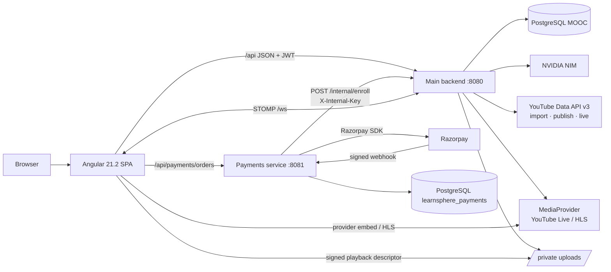
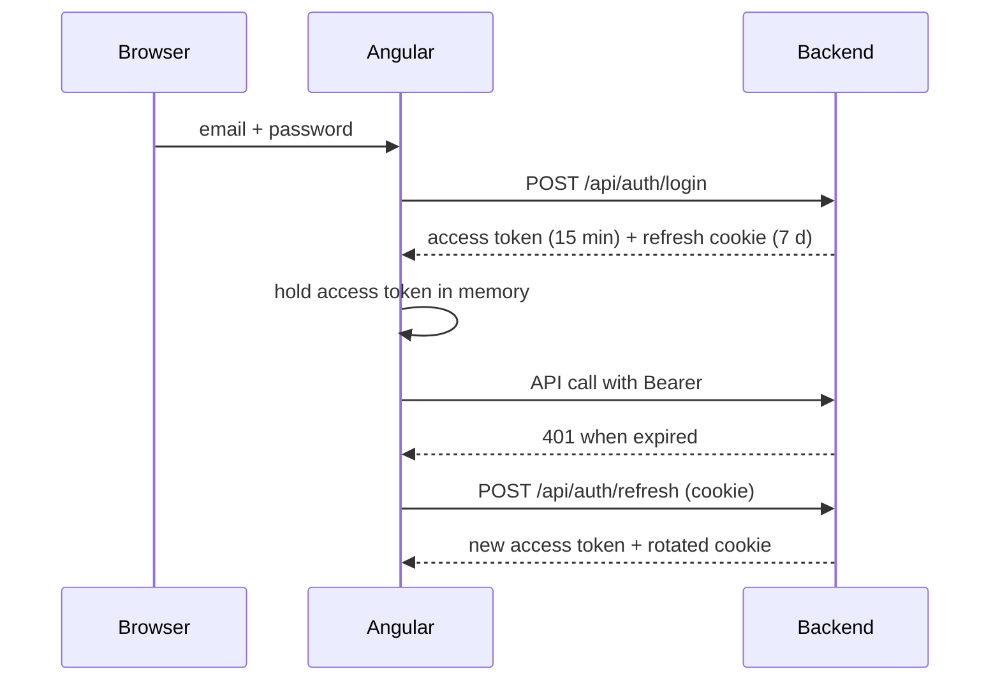
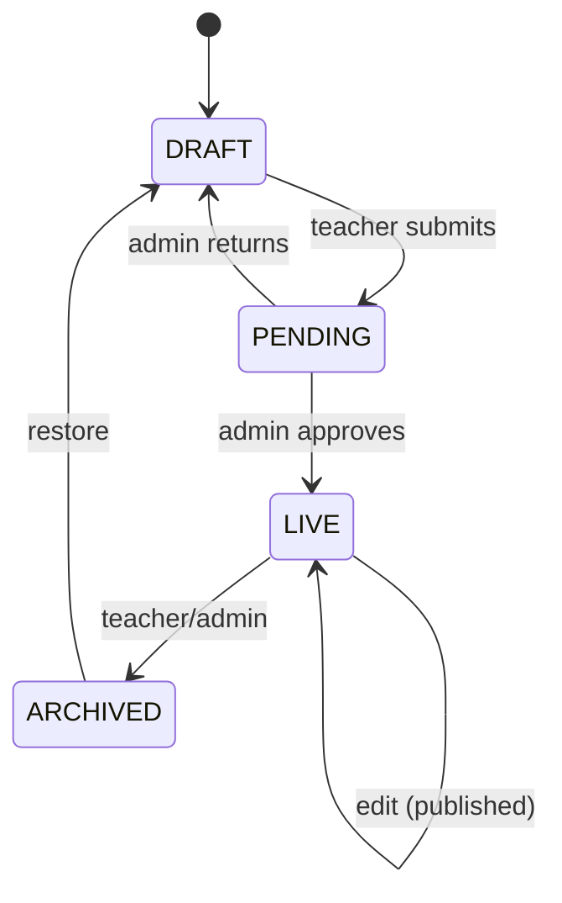
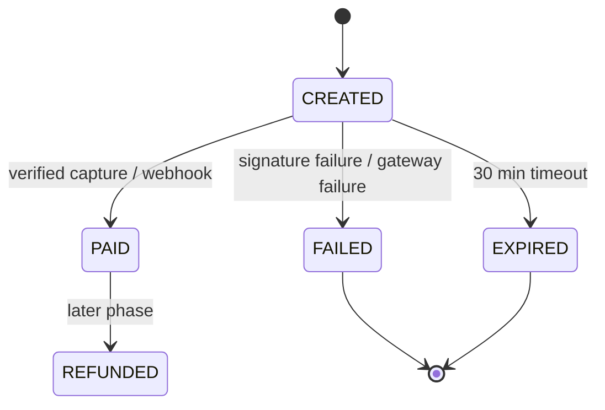
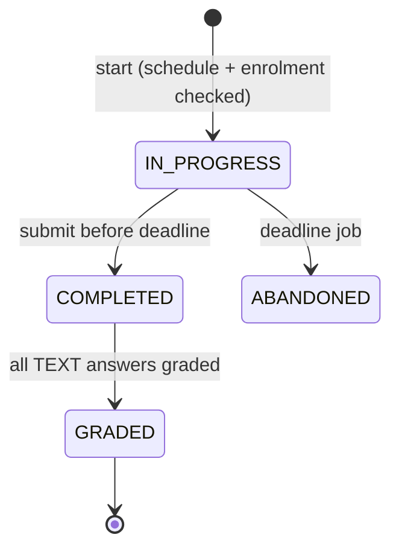
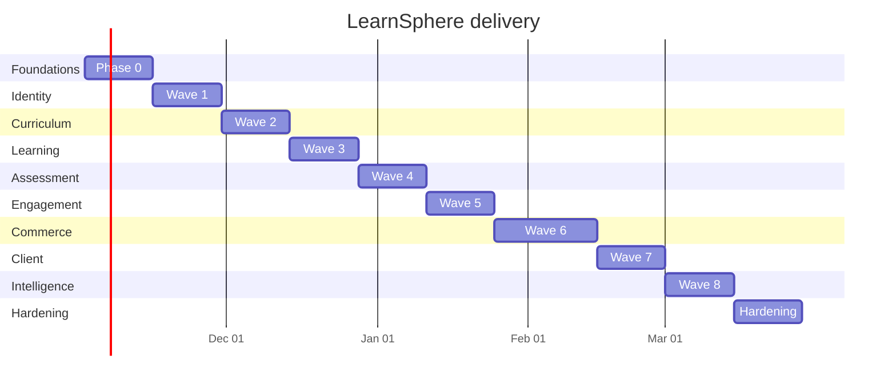

# LearnSphere AI — Development Plan

<!-- Single decision document: WHAT we are building and HOW.
     Written from Docs/analysis/. Every gap is settled by an assumption in §3.
     `AG §n` is a top-level section of AGENTS.md (§1–§10); e.g. `AG §10` is
     Discussion Thread & Post. `REF pn` is a page in the entity reference PDF. -->

| | |
|---|---|
| **Product** | LearnSphere AI — a college-first learning platform for courses, assessments, community and course commerce. |
| **Stack** | Angular 21.2 · Spring Boot 3.3.5 (Java 17) · PostgreSQL · Razorpay payments microservice · NVIDIA NIM · local `/uploads` |
| **Data / source of truth** | PostgreSQL (`MOOC` + `learnsphere_payments`) hydrating a deterministic demo seed; real Razorpay test-mode events for money paths. The frozen contract is `Docs/source/spec.md`. |
| **Open questions** | None blocking. Every gap is settled by A-01…A-27 (§3); every `Q-01…Q-12` from the specification is resolved there. |
| **Plan version** | v1.4 · 2026-10-25 (design-system overlay `DS-01…DS-13`, design conformance NFR, audit overlay, mandatory TDD, performance/caching NFRs, media/player completeness) |

### Document map

| File | Contents |
|---|---|
| `Docs/PLAN.md` | This plan |
| `Docs/plan/waves.md` | Backlog: Phase 0, Waves 1–8, Hardening; every story has an ID, layer, rules and size |
| `Docs/plan/api-catalogue.md` | Every endpoint, its permission and its target state |
| `Docs/plan/schema-usage.md` | Screen/feature → table map, migrations, gaps handled in code |
| [`audit.md`](../audit.md) | Post-build audit (2026-10-24); authoritative source for the remediation overlay `AUD-01…AUD-16` |
| [`Docs/LANDING_PAGE_AUDIT_AND_IMPROVEMENT_PLAN.md`](LANDING_PAGE_AUDIT_AND_IMPROVEMENT_PLAN.md) | Landing-page audit (2026-10-04); source for `DS-04` (dead navigation, hardcoded content, theme/contrast) |
| §12 of this file | Design-system overlay `DS-01…DS-13`; authoritative mapping of design work to waves |
| `Docs/analysis/A…G` | Analysis files, cited as `[A-F1]`, `[B-F6]`, etc. |
| `Docs/source/` | Frozen source pack: `README.md`, `MANIFEST.md`, `spec.md` |
| `TRACKER.md` | Live status; mirrors every story ID in `waves.md` |
| `CLAUDE.md` | Session entry point and hard rules |

Citation convention: `[X-Fn]` is finding **n** in analysis file **X** (`[A-F1]`, `[E-F3]`, `[G-F15]`); `[X-Qn]` is open question **n** in that file. Unprefixed `F1…F23` are this plan's consolidated findings in §2.

---

## 1. What we are building

LearnSphere AI is a single-institution-first LMS with three runtime roles — **STUDENT**, **TEACHER**, **ADMIN** — plus a college directory and affiliation workflow. It combines course authoring, video/content delivery, timed assessments, discussion, certification, AI assistance and course sales.

**Capabilities in this phase**

| Area | What ships | Acceptance spine |
|---|---|---|
| Identity & access | Register/sign in, refresh rotation, account status, roles, college affiliation, ownership checks | AC-01…AC-06 |
| Curriculum | Department → Course → Module → Content/Assignment, ordering, publication, archive, secure uploads, YouTube import and opt-in YouTube publish | AC-07…AC-09 |
| Learning | Enrolment, progress upsert, 90 % completion, player-attached checks, certificates, leaderboards, same-college entitlement | AC-10…AC-14, AC-24 |
| Assessment | Test/attempt lifecycle, server-side timer, question banks, auto/manual grading, integrity controls, content-bound post-video quizzes | AC-15…AC-18 |
| Engagement | Threads/posts, reviews, announcements, notifications, messaging, live sessions with provider playback, moderation | AC-22…AC-23 |
| Commerce | One Razorpay rail, fail-closed verification, idempotent ledger, 70/30 royalty, payouts, college access | AC-19…AC-21 |
| Intelligence | NVIDIA NIM quiz generation, transcript summary, chatbot, graceful fallback | `spec §6` |
| Operations | Migrations, health, CI, structured logs, audit, seed/reset, runbooks | `spec §7` |

**Not in this phase** — each plugs in through a named seam, not a rewrite:

| Deferred item | Seam |
|---|---|
| SMTP / transactional email | `NotificationSender` port; log-only adapter now, SMTP adapter later (`spec §8`) |
| Cloud object storage | `StorageService` port; local-disk adapter now, S3/GCS adapter later (`spec §8`) |
| ExamGuard client | `Test.securityPolicy` string and server timer now; proctoring client later (`spec §8`) |
| Native mobile apps | Responsive Angular SPA and versioned API now (`spec §8`) |
| Multi-tenant isolation | Single-institution deployment; colleges are groupings, not tenants (`spec §8`) |
| Refunds / chargebacks | Payment ledger records gateway ids; refund workflow later (`spec §8`) |
| Live recording, attendance, DRM and in-app RTMP/WebRTC ingest | `LiveMediaProvider` port; provider embed/HLS playback now, recording/attendance/DRM and custom ingest later (A-18, A-26) |
| Uploaded-video transcoding / adaptive-HLS packaging | `MediaProvider`/`StorageService` seams; v1 accepts browser-playable MP4/WebM and plays local uploads through a signed descriptor (A-25) |
| Fine-tuned sentiment / at-risk cron / coding sandbox / LTI | Not started; no schema promises (`spec §8`) |

**Definition of success for the phase:** AC-01…AC-24 demonstrably pass on seed data; every behaviour change has red → green → refactor evidence plus unit and integration coverage; performance, cache-safety and visual-regression gates pass; the money and answer-leak suites block merges; a new developer can start the stack with one command and run the full suite in CI.

---

## 2. What the documents tell us

| # | Finding | How we handle it |
|---|---|---|
| F1 | Role naming drifts: `INSTRUCTOR` in the reference, `TEACHER` in code and seed (`spec Q-01`; `REF p4`; `code DataSeeder.java:49-51`). | A-01: `TEACHER` is the only runtime code; `INSTRUCTOR` is a display/spec alias. No data migration. |
| F2 | Physical schema drifts: singular reference tables vs plural runtime tables, `Long` vs `Integer` ids, and alias accessors (`[A-F1]`; `REF p3`). | A-02: freeze the deployed physical names; no mass rename; new entity tables plural `snake_case`, infrastructure logs/outbox singular. A-03: API exposes `department_id`/`role_id` as `Integer` while the deployed `BIGINT` columns are a recorded physical mapping. |
| F3 | Account deactivation is inconsistent: `status` instead of `is_active`, `FLAGGED` can sign in, `isEnabled()` is always true (`[A-F4]`). | A-23: explicit `ACTIVE/FLAGGED/BLACKLISTED` lifecycle; only `BLACKLISTED` blocks login; `is_active` derived. |
| F4 | Session violates the hard rule: 24 h JWT, no refresh token, no `dept_id`, default secret, token in `localStorage` (`spec §7`; `AG §3`; `[A-F5, A-F6, G-F3]`). | A-09: 15 min access in memory + 7 day rotating refresh cookie; remove `localStorage`; secret from env. Wave 1. |
| F5 | Authorization is authentication-only across curriculum, tests and enrolment; IDOR on enrol/roster/progress (`[A-F7, A-F8, B-F7, C-F2, C-F3, C-F6, D-F2]`). | One ownership layer (§6.4); every mutating controller calls it; IDOR regression suite blocks merges. Wave 1. |
| F6 | Two unlinked curriculum models: `Lecture` and `Module → CourseContent` (`spec Q-05`; `[B-F1]`). | A-05: `CourseContent` is canonical; migrate `Lecture` 1:1; no dual writes. Wave 2. |
| F7 | Publication is not enforced on enrolment; drafts can be bought/joined (`spec AC-10`; `[B-F3, B-F4, C-F1]`). | A-04: `status` is canonical and `isPublished = status == LIVE`; enrol/checkout require `LIVE`. Waves 2–3. |
| F8 | Course delete is a hand-written hard cascade; position gaps survive deletes (`[B-F5, B-F6]`). | Archive/soft-delete for courses; re-normalise module/content positions after every delete. Wave 2. |
| F9 | Progress is integer, non-upsert, duplicates allowed, completion is 100 % and lecture-based (`spec Q-08`; `[C-F4…C-F7]`; `REF p12`). | A-08/A-10: unique `(user, content)`, upsert, `BigDecimal(5,2)`, 90 % completion, content-based aggregation. Wave 3. |
| F10 | Certificates hard-code the grade; course leaderboard is never written; no async recalculation (`[C-F9…C-F11]`). | Real grade/score on the certificate; materialise leaderboard after attempt completion; XP rank is separate and labelled. Wave 3. |
| F11 | Legacy assessment endpoints leak `correctAnswer`; three assessment surfaces with different guards (`spec AC-15`; `[D-F1, D-F2, D-F12]`). | Retire legacy `/api/tests` writes and the leaky question reads; `/api/assessments` becomes the only student surface. Wave 4. |
| F12 | TEXT answers are auto-awarded full marks; duplicate answer rows inflate the score (`spec AC-17`; `[D-F3, D-F4]`). | One answer per `(attempt, question)` with upsert; TEXT stays `null` until manual grading. Wave 4. |
| F13 | Attempts have no timestamps, no `ABANDONED`, no server timer; `scheduledAt` is unenforced (`spec AC-18`; `[D-F5…D-F7, D-F10]`). | Server-owned `startedAt/completedAt`, timeout job, `ABANDONED`, schedule check on start. Wave 4. |
| F14 | MCQ options live in `question_options`, not `extra`; AI writes the legacy table (`spec Q-12`; `[D-F8, B-F10]`; `REF p15`). | A-12: `extra` JSON is canonical; migrate and drop `question_options`; validate correct answer against options. Wave 4. |
| F15 | Two discussion models, no enrolment gate, `Lecture`-bound notes/bookmarks, unauthorized STOMP `SUBSCRIBE` (`[E-F1…E-F3, E-F10, E-F15]`). | A-13…A-16: thread/post canonical, enrolment-gated community, content-bound notes/bookmarks, destination-level WebSocket auth. Waves 1, 2, 5. |
| F16 | Two payment rails, fail-open verify, unauthenticated simulate, internal amount trust, fabricated history, auto-minted royalties (`spec AC-19…AC-21`; `[F-F1…F-F10]`). | A-06/A-07/A-19/A-21: one Razorpay rail, fail-closed, idempotent, server-priced, one ledger. Wave 6. |
| F17 | Teachers can self-attach to a college at registration; `verifiedCollegeGuard` is dead; same-college free access is absent (`[F-F12…F-F15]`; `README.md:62,81`). | A-20/A-24: affiliation approval gates authoring; same-college entitlement enforced server-side. Wave 6. |
| F18 | Client/ops drift: Angular 19 docs vs 21.2 code, 61 eager route entries, dead `store/`, hard-coded localhost, no CI/Docker/migrations/health, seeded default passwords (`[G-F1…G-F17]`). | Angular 21 baseline, lazy route groups, env injection, CI, Flyway, actuator, seed profile. Phase 0 + Wave 7. |
| F19 | Status docs overclaim: `Progress.md` says production-candidate/feature-complete; README promises a teacher-80/platform-20 split, Docker and free access (`[G-F12, G-F13]`). | This plan + `TRACKER.md` are the status source; stale claims corrected in H-07. No document may claim a wave before its gate. |
| F20 | There is one stale test per tier and no CI (`[G-F8, G-F9]`). | Phase 0 builds the harness first: hermetic backend tests, a real frontend test, contract tests, Playwright smoke, CI on every push. |
| F21 | The 2026-10-24 post-build audit found remaining P0/P1 gaps in legacy user authorization, session storage, payment verification/history, receipt generation, student course surfaces and teacher/admin profiles (`audit.md` §A–§E). | Audit remediation is an **overlay on the owning waves**, not a late feature wave. Each finding is tracked as `AUD-01…AUD-16` and mapped to W1/W3/W6/W7 in §11. P0 audit items must close before the owning wave gate; P1 items before release; P2/P3 items may move to H-09 only with a tracker deviation. |
| F22 | Media delivery is overstated and internally inconsistent: YouTube support is import/metadata only, the live room is a simulated screen broadcast, and §6.8 says videos are YouTube URLs while the teacher UI exposes local video upload (`UploadController`, `VideoPlayerComponent`, `live-room.component.html`; `Docs/Future_Plans.md`). | A-25/A-26: one canonical media source, private uploads with signed playback, opt-in YouTube publish and provider-backed live playback. New stories W2-12, W2-13, W5-10; §6.8 rewritten; docs corrected in H-07. |
| F23 | The post-video quiz is a client-only modal. It is bound to a legacy `Lecture`, has a client-side 60 % pass threshold, and can mark completion without a server-verified passing attempt; retakes, attempt limits and error paths are not enforced (`PostVideoQuizComponent`, `LectureComponent`, `Test.lecture`). | A-27/BR-25: bind tests to `CourseContent`, make the server the sole authority for pass and completion, and deliver the quiz in the existing player shell. Story W4-11; migration M-14. |
| F24 | The visual layer has no system in force: `ThemeService` defaults to dark for every visitor (`theme.service.ts:61`), while the landing hardcodes light section backgrounds (`landing.component.html:69,120,195,226,270`) — measured `#f8fafc` text on `#ffffff` (1.03:1), so four sections are invisible on first load; `.h2/.sec-label/.sub/.divider` are used but defined nowhere (computed `16px/400`), collapsing every section heading to body size; login inputs render `#0f172a` on a white card. The token layer is bypassed: 723 hex literals across SCSS, 18 border radii (1–9999 px), two palettes (landing's `#1D9E75/#BA7517/#993556` exist in no token), 269 inline styles in 13 templates, 341 Lucide vs 10 `mat-icon`, 84 uppercase rules, 117 `transition: all`, 52 hover `translateY`. The landing hero is a centred text stack with zero imagery in 69 templates, and its stats/courses/prices are invented. | A-28/ADR-16/NFR-04: tokens are the only styling authority; the public/auth surfaces are explicitly in scope for redesign (`DS-02…DS-05` fix legibility first, `DS-08/DS-09` rebuild after the direction decision); in-app role shells keep their layout under NFR-01 until their owning DS story. Every design claim is gated by a Playwright baseline at 360/768/1280 px and a token lint. |

---

## 3. Working assumptions (taken from the documents)

Every assumption is a setting or a single code path; it can change later without redesign. None is unresolved.

| ID | Topic | Assumption | Basis |
|---|---|---|---|
| A-01 | Role naming | Runtime code is `TEACHER`; `INSTRUCTOR` is accepted only as a documentation/display alias and maps to `TEACHER`. Seeded roles are `ADMIN`, `TEACHER`, `STUDENT`. | `spec Q-01`; `AG §2`; `code DataSeeder.java:49-51` |
| A-02 | Physical schema | Deployed table names are frozen (`users`, `courses`, `enrollments`, `module`, `assignment`, `post`, `discussion_thread`, `course_content`, …). Singular/plural is not a contract; no mass rename. New entity tables are plural `snake_case`; append-only infrastructure tables use the conventional singular (`audit_log`, `notification_outbox`). | `spec Q-02`; `REF p3`; `[A-F1]` |
| A-03 | Department | `Course.department_id` FK is canonical; the existing `department` string is a display label kept only for transition/backfill. New course writes require the FK. API ids for department/role are `Integer`; the deployed `BIGINT` columns are a recorded physical mapping (A-02) and are range-checked, so no mass type migration. | `spec Q-03`; `REF p3, p7`; `[B-F2]` |
| A-04 | Publication | `Course.status ∈ {DRAFT, PENDING, LIVE, ARCHIVED}` is canonical; `isPublished` is derived as `status == LIVE`. Only admin moves `PENDING → LIVE`. | `spec Q-04`; `REF p7`; `[B-F3]` |
| A-05 | Curriculum | `Module → CourseContent` is canonical for authoring, playback and progress. `Lecture` is legacy; migrate it 1:1, then keep it read-only and stop dual writes. | `spec Q-05`; `REF p9`; `[B-F1]` |
| A-06 | Payment rail | The Razorpay microservice is the only production checkout. The simulated main-backend checkout is removed from the UI and its verify path is disabled; local development uses Razorpay test mode or a `test`-profile fake. | `spec Q-06`; `spec §6`; `[F-F1…F-F5]` |
| A-07 | Royalty split | Teacher 70 %, platform 30 %. The README's teacher-80/platform-20 split is corrected. | `spec Q-07`; `spec AC-21`; `[F-F11]` |
| A-08 | Completion | Content is complete at `progressPercent >= 90`, clamped to 100; where a required post-video quiz is attached, a finalized passing attempt is also required (A-27). A certificate requires every required content item to reach that threshold. | `spec Q-08`; `REF p12`; `[C-F5]` |
| A-09 | Session | Access token: 15 minutes, held in memory only. Refresh token: 7 days, `HttpOnly; Secure; SameSite=Lax` cookie, rotated on use and revoked on logout. `localStorage` is removed. | `spec Q-09`; `spec §7`; `AG §3`; `[G-F3]` |
| A-10 | Numeric types | Progress `BigDecimal(5,2)`, marks/score `BigDecimal(8,2)`, averages `BigDecimal(6,2)`, money `BigDecimal(12,2)`. Integer columns are migrated. | `spec Q-10`; `REF p12, p15`; `[D-F9]` |
| A-11 | Role selection | Public registration creates `STUDENT` only. A teacher application requires admin approval; `ADMIN` is seeded, never self-registered. | `spec Q-11`; `AG §2`; `[A-F3]` |
| A-12 | MCQ storage | `Question.extra` holds the options JSON array; `question_options` is migrated and dropped. `correctAnswer` must match exactly one option. | `spec Q-12`; `REF p15`; `[D-F8]` |
| A-13 | Discussion model | `discussion_thread` + `post` is canonical; legacy `discussion_posts` is migrated/retired. Replies are two levels (`parentPost`), and a parent must belong to the same thread. | `[E-Q1]`; `REF p21-22`; `[E-F1]` |
| A-14 | Community access | Reads: enrolled students, course staff, admin. Writes: enrolled students and course staff (admin override). Public catalogue pages never expose course discussions. | `[E-Q2]`; `[E-F3]` |
| A-15 | Notes/bookmarks | Both bind to `CourseContent`, not `Lecture`; legacy rows are migrated. A timestamp must be `0 <= t <= durationSeconds`. | `[E-Q3]`; `AG §4`; `[E-F10]` |
| A-16 | WebSocket auth | `SUBSCRIBE` is authorized per destination: `/user/**` owner only; `/topic/course/{id}` enrolment or course staff; `/topic/admin/**` admin. | `[E-Q4]`; `spec §6`; `[E-F15]` |
| A-17 | Announcements/notifications | Teacher announcements are course-scoped; admin announcements may be global. A fixed event catalogue creates notifications (enrolment, grade, feedback, thread reply, live start, announcement). | `[E-Q5]`; `[E-F13, E-F14]` |
| A-18 | Live sessions | Join links are enrolment-gated (course staff/admin override). Attendance tracking and recordings are out of scope for v1. | `[E-Q6]`; `[E-F16]` |
| A-19 | Internal enrolment | `/internal/enroll` recomputes the price from the course, ignores any body `amount`, requires the internal key plus a service identity, and writes the ledger at most once per gateway payment id. | `[F-Q3]`; `spec §6`; `[F-F6, F-F7]` |
| A-20 | College entitlement | A student whose `college` equals the course teacher's **verified** college gets free access; no payment row is created. UI shows "Included by your college"; admin can grant/revoke an override. | `[F-Q4]`; `README.md:62`; `AG §4` |
| A-21 | Payment ledger | The main `payments` table is the canonical financial ledger, keyed by a unique gateway payment id. The microservice mirrors gateway state; fabricated rows are forbidden. Revenue and royalties both derive from this ledger. | `[F-Q5]`; `spec AC-20`; `[F-F8…F-F10]` |
| A-22 | Payout | Payout is an admin-initiated DB settlement in v1 (no bank API), minimum ₹500, monthly cadence, locked and idempotent, with a teacher-visible statement. | `[F-Q6]`; `README.md:56`; `spec §4 SCR-55` |
| A-23 | Account lifecycle | `status ∈ {ACTIVE, FLAGGED, BLACKLISTED}`. Only `BLACKLISTED` blocks login; `FLAGGED` can sign in but cannot author, pay or post until reviewed; `is_active` is derived (`status != BLACKLISTED`). | `[A-Q3]`; `spec AC-01`; `[A-F4]` |
| A-24 | Affiliation gate | A teacher must have an `APPROVED` affiliation to a `VERIFIED` college to create or publish courses. Admin can override with an audit entry. | `[F-F12, F-F13]`; `AG §4`; `README.md:81` |
| A-25 | Video source and publishing | `CourseContent` has exactly one active video source: `YOUTUBE` (linked/imported or a platform-published copy), `UPLOAD` (private storage key), or `EXTERNAL` (staff-supplied non-secret URL). Local uploads are private and played only through a short-lived, entitlement-bound descriptor; no filesystem path or public `/api/uploads/**` URL is exposed. YouTube publishing is opt-in per teacher channel, uses OAuth and an idempotent unlisted `videos.insert` job, and keeps the local master. Publishing records the provider id but does not silently switch the active source; the teacher must explicitly select the published copy. V1 accepts browser-playable MP4/WebM; no transcoding or adaptive packaging. Publishing depends on a Google OAuth client with the YouTube upload scope and available quota; if that approval is unavailable, W2-13 stays feature-flagged off and local upload/playback is unaffected. | F22; `spec §6`; `[B-F9]`; current upload/YouTube code |
| A-26 | Live media | `live_sessions` store a validated provider playback source (`YOUTUBE_LIVE` video id or HTTPS HLS manifest); the teacher supplies the broadcast/playback URL and LearnSphere embeds/plays it. RTMP URLs and encoder stream keys are rejected and never stored. There is no in-app RTMP/WebRTC ingest, automatic YouTube broadcast creation, recording, attendance or DRM in v1. Playback descriptors are released only while `LIVE` and only to enrolled/course staff/admin; for HLS the descriptor carries the playback URL (or the provider's signed URL), never a stream key. Provider unlisted URLs reduce casual sharing but are not DRM. The teacher must enable live streaming/embedding on the provider; HLS must be browser-reachable (CORS). A provider/format failure shows an explicit unavailable state, never a simulated stream. | A-18; F22; `[E-F16]`; `Docs/Future_Plans.md` |
| A-27 | Player-attached quiz | A `Test` may bind to one `CourseContent` with `placement=POST_VIDEO`; at most one required post-video quiz exists per content. A required quiz gates completion: the 90 % watch rule still records progress, and `completedAt` requires **both** watch ≥90 % and a finalized passing attempt. `passThreshold` defaults to 60 % and `maxAttempts` to 3 (0 = unlimited), both server-side. A pass is sticky: a later failed retake or quiz edit does not revoke completion unless the 90 % watch condition itself regresses. Adding or changing a required quiz applies to future completions and does not retroactively revoke completed content or issued certificates. Optional quizzes do not gate completion. | F23; AC-12, AC-18; current `PostVideoQuizComponent` |
| A-28 | Design authority and direction | Styling has exactly one authority: the token layer (`src/styles/_tokens.scss` re-exported by `_variables.scss`). No hex literal, ad-hoc radius, shadow or font size outside it; screens compose tokens and shared components. Two surfaces are explicitly in scope for redesign — **public/marketing** (landing) and **auth** (login, register, forgot, verify-college) — because they are unowned by any feature wave and currently broken (F24). In-app role shells keep their composition and spacing under NFR-01 until their owning DS story. The visual direction is decided once, at `DS-08`, by the client from two named candidates: **"verified"** (the verification stamp/seal as the recurring structural device; ink/paper/seal palette; editorial display face + neutral UI face; transcript-grade tabular numerals) or **"campus notice-board"** (board green, stamp violet, pinned-card physics, faculty names as the hero asset). The decision is recorded in `TRACKER.md` §4 and is not revisited per screen. The default theme is light for public routes and the last explicit choice for in-app routes; `prefers-color-scheme` may set the *initial in-app* value only. | F24; `theme.service.ts:61`; `landing.component.html:69`; `_typography.scss`; `Docs/LANDING_PAGE_AUDIT_AND_IMPROVEMENT_PLAN.md` §2.7 |

---

## 4. Architecture

### 4.1 Principles

1. **One authority per rule.** The spec/REF contract wins over prose; one curriculum model, one payment rail, one financial ledger, one role vocabulary (A-01, A-05, A-06, A-21).
2. **Server is the authority.** Price, score, completion, publication and permissions are computed server-side; the client only renders them (`spec §7`; AC-16, AC-18, AC-19).
3. **Money and answers are idempotent.** Every money/answer write carries a natural key and is safe to retry (AC-15, AC-20).
4. **Ownership is explicit.** Every resource has one owner predicate, called by every mutating endpoint (§6.4; AC-04, AC-22).
5. **Brownfield, not rewrite.** Existing working surfaces are kept and hardened; physical schema names are frozen (A-02). Dead or duplicate paths are retired only after a replacement is proven.
6. **Docs are the interface.** A story cites a rule and an assumption; a claim without a citation is not accepted (`Docs/source/spec.md`; this plan).
7. **Deferred means seam, not silence.** Email, cloud storage, proctoring and refunds have ports and explicit non-goals (`spec §8`).

### 4.2 Component diagram



### 4.3 Components

| Component | Responsibility | Key boundaries |
|---|---|---|
| Angular SPA | Three role shells, 61 route entries / 47 distinct screens, VOD/live player, in-player quiz, assessments, commerce UI, admin console | No business authority; lazy route groups; tokens in memory (A-09) |
| Main backend | Identity, curriculum, enrolment/progress, assessments, engagement, media authorization/publishing, royalties, admin, AI/YouTube | Owns `MOOC` schema; exposes `/api/**` and `/internal/**` |
| Payments service | Razorpay order creation, signature verification, webhook ingestion, order state | Owns `learnsphere_payments`; calls only `/internal/enroll`; no direct DB access to `MOOC` |
| PostgreSQL `MOOC` | Canonical academic + financial ledger | Migrations via Flyway; `ddl-auto=validate` |
| PostgreSQL `learnsphere_payments` | Gateway order/payment mirror | Migrations via Flyway; idempotency keys |
| NVIDIA NIM | Quiz extraction, summary, chatbot | Timeout + graceful fallback (`spec §6`) |
| YouTube Data API | Playlist metadata, transcripts, embed metadata, opt-in resumable upload | Quota-aware; OAuth token encrypted; no token in client/logs |
| MediaProvider (port) | Normalises live provider descriptors (`YOUTUBE_LIVE`, `HLS`) and isolates the player from provider details | Provider URLs validated; fake adapters in tests; no stream keys to the client (A-26) |
| Private `/uploads` | Avatars, resources, assignment files, local video masters | 200 MB limit; type validation; signed playback; storage port for later S3 |

### 4.4 Key flows

**Sign-in and refresh**



**Purchase and enrolment (canonical rail)**

```mermaid
sequenceDiagram
    participant S as Student
    participant FE as Angular
    participant PS as Payments service
    participant RZ as Razorpay
    participant BE as Main backend
    S->>FE: Buy course
    FE->>PS: POST /api/payments/orders {courseId}
    PS->>PS: authenticate user; load course price<br/>from main backend
    PS->>RZ: create order
    RZ-->>FE: checkout modal
    FE->>PS: POST /api/payments/orders/verify
    PS->>PS: verify HMAC (fail closed) + idempotency
    PS->>BE: POST /internal/enroll {userId, courseId, gatewayPaymentId}
    BE->>BE: recompute price; check entitlement;<br/>write enrolment + ledger + 70 % royalty once
    BE-->>PS: enrolment + ledger id
    PS-->>FE: paid
    RZ->>PS: webhook payment.captured (backup)
```

**Learning and progress**

```mermaid
sequenceDiagram
    participant S as Student
    participant FE as Angular
    participant BE as Backend
    S->>FE: play content
    FE->>BE: POST /api/progress {contentId, percent, seconds}
    BE->>BE: upsert (user, content); clamp; set completedAt at >= 90
    BE-->>FE: progress row
    FE->>BE: GET /api/student/courses/{id}/progress
    BE-->>FE: computed completion + certificate eligibility
```

**Assessment submit**

```mermaid
sequenceDiagram
    participant S as Student
    participant FE as Angular
    participant BE as Backend
    S->>FE: start test
    FE->>BE: POST /api/assessments/{id}/start
    BE->>BE: check schedule, enrolment, attempt limit;<br/>create attempt with server time
    S->>FE: answers
    FE->>BE: POST /api/assessments/attempts/{id}/answers
    BE->>BE: upsert one answer per question
    FE->>BE: POST /api/assessments/attempts/{id}/finalize
    BE->>BE: enforce deadline; auto-grade MCQ/TF;<br/>leave TEXT null; compute score
    BE-->>FE: result + review
```

### 4.5 Environments

| Environment | Topology | Data | Purpose |
|---|---|---|---|
| Local | 3 processes + 2 PostgreSQL databases + `uploads/` | Demo seed + Razorpay test mode | One-command development (`spec §7`) |
| CI | GitHub Actions: backend tests (Testcontainers PostgreSQL), frontend unit + build, Playwright smoke | Ephemeral containers + seed | Every push/PR; blocks merge |
| Pilot | One app VM (backend + payments + static frontend) + managed PostgreSQL; TLS reverse proxy | Real pilot data; Razorpay live/test as configured | Single-institution pilot |
| Production later | Containers + managed PostgreSQL + object storage | Migrated pilot data | Out of scope for this phase; seams exist |

### 4.6 Cost — sized for this phase

| Driver | Sizing | Note |
|---|---|---|
| App compute | 1 small VM (2 vCPU / 4 GB) runs backend + payments + static frontend | Pilot scale; split when needed |
| PostgreSQL | 1 managed instance, 2 databases | Backups daily; no read replica |
| Razorpay | Per-transaction merchant fee | Only on successful payments |
| NVIDIA NIM | Per-token, capped by timeout/fallback | Cache summaries; no background bulk generation |
| Storage | Local disk ≤ 20 GB | 200 MB/upload limit; S3 later |
| Observability | Logs + uptime check only | No paid APM in this phase |

### 4.7 Architecture decisions

| ADR | Decision | Why not the alternative |
|---|---|---|
| ADR-01 | The frozen spec/REF contract wins over README/Progress prose. | Prose has already drifted (Angular 19, 80/20, H2); the code plus spec is testable. |
| ADR-02 | Keep deployed physical schema names; no mass rename. | Renaming 36 entities/tables adds risk with zero user value (A-02). |
| ADR-03 | Razorpay microservice is the only checkout. | Two rails produced two ledgers and a fail-open path (A-06; F16). |
| ADR-04 | Main `payments` is the single financial ledger keyed by gateway payment id. | The microservice DB is operational; revenue/royalty must read one place (A-21). |
| ADR-05 | `CourseContent` is canonical; `Lecture` is migrated then read-only. | The player/progress/certificate stack already uses lectures, but the reference model is content (A-05). |
| ADR-06 | Angular 21.2 is the baseline; lazy-load role route groups. | Docs say 19 but the lockfile is 21.2; 61 eager routes break the performance budget (G1, G2). |
| ADR-07 | Flyway + Testcontainers PostgreSQL; `ddl-auto=validate`. | `ddl-auto=update` has no history and tests need a real database (G9). |
| ADR-08 | Access token in memory; refresh in HttpOnly cookie. | The hard rule forbids `localStorage`; a refresh cookie removes XSS token theft (A-09). |
| ADR-09 | GitHub Actions + Docker Compose for local/CI. | No pipeline or container exists today; one-command run is an NFR (G9). |
| ADR-10 | Errors use RFC 9457 `application/problem+json` with stable `code` values. | Current errors are ad-hoc strings; clients need stable branches. |
| ADR-11 | One answer row per `(attempt, question)` with upsert; TEXT manual. | Append-only rows inflated scores; auto-full-marks defeated free text (F12). |
| ADR-12 | Notifications are written to an outbox table and delivered by a poller. | Direct sends inside transactions lose events and block requests. |
| ADR-13 | In-process Caffeine caches public DTO read models; the database stays authoritative; private reads bypass the cache and send `no-store`. | Redis/CDN adds pilot operations and leak surface; introduce Redis only if horizontal scale requires a shared cache (NFR-03; W2-11). |
| ADR-14 | Media is provider-neutral: `CourseContent` stores one source descriptor; local uploads are private and played through a short-lived signed descriptor; YouTube is an optional publish target; live uses a `MediaProvider` (YouTube Live/HLS) instead of a simulated room or custom ingest. | A raw-YouTube-only model contradicts the existing upload UI; custom streaming infrastructure is outside pilot scope. The port keeps S3/HLS/proctoring options open without a rewrite (A-25, A-26; W2-12, W2-13, W5-10). |
| ADR-15 | `Test` may bind to `CourseContent`; the server owns post-video pass and completion. The player renders the quiz in place but cannot complete the content by itself. | The lecture-bound client modal can mark completion without a pass and cannot enforce retakes or answer privacy. One assessment engine plus a content binding avoids a second quiz system (A-27; W4-11). |
| ADR-16 | Design work is an **overlay on the waves that touch the surface**, sequenced with them, not a ninth wave and not a big-bang restyle. Legibility and theme defects ship first as fixes; the identity decision ships once; each screen is converted in the wave that already edits it. | A separate design wave would ship a broken landing until W7 and would rewrite screens twice; a big-bang restyle would collide with every feature branch and invalidate the visual baselines. The overlay keeps one baseline per screen and one direction per product (A-28; F24). |

---

## 5. Tech stack and repository

| Layer | Choice | Version / note |
|---|---|---|
| Frontend | Angular standalone components, SCSS tokens, Lucide, RxJS | 21.2 (`package.json:18`), TypeScript 5.9, Vitest 4 |
| Backend | Spring Boot, Spring Security, Spring Data JPA, Bean Validation | 3.3.5, Java 17 (`learnsphere-backend/pom.xml:8,30`) |
| Payments | Spring Boot + Razorpay Java SDK | 3.3.5, Java 17, port 8081 |
| Database | PostgreSQL, Flyway | `MOOC`, `learnsphere_payments`; `ddl-auto=validate` after baseline |
| AI | NVIDIA NIM `meta/llama-3.1-70b-instruct` | `spec §6`; timeout + fallback |
| Media | YouTube Data API v3 (import, opt-in publish); private `/uploads`; YouTube Live/HLS playback via `MediaProvider`; native HLS or lazy `hls.js` | 200 MB limit; signed playback descriptors; no transcoding in v1 |
| Tests | JUnit 5, Testcontainers, Vitest, Playwright; test-first workflow | New in Phase 0; every story starts red |
| CI/CD | GitHub Actions | New in Phase 0 |
| Runtime | Docker Compose (local/CI); single VM (pilot) | New in Phase 0 |

**Repository tree (canonical paths)**

```
/
├─ Docs/                         source/, analysis/, plan/, PLAN.md
├─ learnsphere-backend/          Spring Boot main service (canonical backend)
├─ learnsphere-payments-service/ Razorpay microservice
├─ learnSphere/frontend/learnsphere/ Angular 21.2 SPA
├─ uploads/                      runtime files, gitignored
├─ project-docs-template/        docs tooling — context only, never shipped
├─ .github/workflows/            CI (added in P0-03)
├─ docker-compose.yml            local stack (added in P0-05)
├─ AGENTS.md                     domain/reference guide
├─ CLAUDE.md                     session entry point
├─ TRACKER.md                    live status
├─ README.md / RUNNING.md        user-facing docs, corrected in H-07
└─ Docs/source/spec.md           frozen contract
```

**Hygiene:** the root `pom.xml`, `mvnw`, `mvnw.cmd` and `.mvn/` are a stale duplicate of `learnsphere-backend/` with no `src/`; P0-07 removes them or turns the root into a real aggregator. One build path only.

---

## 6. Backend design

### 6.1 Modules and packages

| Package | Responsibility |
|---|---|
| `Controller` | HTTP mapping, validation entry, principal extraction; no business rules |
| `Service` / `Service.impl` | Transactions, ownership, state transitions, ledger writes |
| `Service.media` | Media source validation, entitlement-bound playback descriptors, YouTube OAuth/publish jobs and live provider adapters; no provider SDK types in controllers |
| `Repository` | Spring Data JPA + explicit queries; no business logic |
| `Entity` | JPA mappings; no presentation logic |
| `Dto` | Request/response contracts; never expose entities with secrets |
| `Security` | JWT filter, principal, WebSocket auth, permission helpers |
| `Config` | Security, CORS, WebSocket, seed, OpenAPI |
| `Exception` | Problem+JSON mapping, stable error codes |

### 6.2 API conventions

- Base path `/api`; internal service path `/internal`; JSON camelCase; ISO-8601 UTC timestamps.
- Errors: `application/problem+json` with `type`, `title`, `status`, `detail`, `code`, `traceId` (ADR-10).
- API IDs: `Long` for user/course/content/test/attempt/payment; `Integer` for department/role (A-02, A-03). Physical `BIGINT` for department/role is a recorded mapping, not a contract change.
- Pagination: `?page=0&size=20&sort=field,asc`; responses `{content, page, size, totalElements, totalPages}` for new list endpoints. Existing list endpoints keep their shape until their wave.
- Idempotency: `Idempotency-Key` on order creation; natural keys on answer/progress/enrolment writes.
- Payment DTOs use `CREATED/PAID/FAILED` at the API boundary and one documented amount unit (paise for gateway-facing DTOs); the UI never hard-codes `PAID` (BR-21; `audit.md` B1–B6).
- Cache headers are part of the contract: public catalogue/reference reads return `ETag` + `Cache-Control: public, max-age=60, stale-while-revalidate=30`; auth, profiles, progress, attempts/answers, payments/receipts/royalties, admin lists, uploaded-file downloads, media playback descriptors/signed URLs, live playback descriptors and YouTube connection/publish jobs return `Cache-Control: private, no-store` (NFR-03).
- Auth: `Authorization: Bearer <access>`; refresh via HttpOnly cookie; internal calls use `X-Internal-Key` + `X-Service-Id`.
- No entity is returned directly where it contains `password`, `correctAnswer`, `internalKey` or another user's payment data.

### 6.3 Authentication and account lifecycle

- `POST /api/auth/login` → access token (15 min) + refresh cookie (7 days). Claims: `userId`, `roles`, `dept_id` (`spec AC-05`).
- `POST /api/auth/refresh` rotates the refresh token; reuse of an old token revokes the family (A-09).
- `POST /api/auth/logout` revokes the refresh token and clears the cookie.
- Account `status`: `ACTIVE` (full), `FLAGGED` (read-only; no author/pay/post), `BLACKLISTED` (login rejected) (A-23; AC-01).
- Passwords: BCrypt, minimum length server-side; never in any response (AC-02).
- Login rate limit: per-IP + per-account counters; lockout after 5 failures in 15 minutes; audit event (A-F10).

### 6.4 Authorization matrix

| Resource | Public | Student | Teacher | Admin |
|---|---|---|---|---|
| Published catalogue, course detail | Read | Read | Read | Read |
| Course create/update/archive | — | — | Own courses (A-24) | Any |
| Module/content/assignment write | — | — | Own course | Any |
| Enrolment | — | Self only | Course roster (own course) | Any |
| Progress | — | Self only | Read own-course roster | Read any |
| Uploaded file download | — | Owner or linked-course enrolment | Own course | Any |
| Content playback descriptor | — | Enrolled only | Own course | Any |
| Live playback descriptor | — | Enrolled, `LIVE` only | Own course | Any |
| YouTube channel/publish | — | — | Own connection/jobs | Audit only; never tokens |
| Test/question write | — | — | Own course | Any |
| Attempt | — | Own, enrolled, scheduled | Read own-course attempts | Any |
| Answers/grade | — | Own attempt | Own-course manual grade | Any |
| Thread/post/review | — | Enrolled read/write | Own-course read/write | Any |
| Notes/bookmarks | — | Self only | Self only | Self only |
| Payment/royalty | — | Own payments | Own royalties | Any |
| Payout | — | — | Read own statement | Process |
| Internal enrol | Service key | — | — | — |

Every row maps to a single helper: `Ownership.requireCourseStaff(courseId)`, `requireEnrolled(courseId)`, `requireSelf(userId)`, `requireAdmin()`. No controller re-implements the predicate.

### 6.5 State machines

**Course**



**Payment / order**



**Test attempt**



### 6.6 Business rules

| ID | Rule | Source |
|---|---|---|
| BR-01 | A `BLACKLISTED` account cannot authenticate; `FLAGGED` is read-only. | AC-01; A-23 |
| BR-02 | Passwords and `correctAnswer` never appear in a student-facing response. | AC-02, AC-15 |
| BR-03 | Only admin assigns/revokes global roles. | AC-03 |
| BR-04 | Only the course creator or admin mutates that course's curriculum. | AC-04; A-24 |
| BR-05 | Access 15 min / refresh 7 days; access in memory only. | AC-06; A-09 |
| BR-06 | Modules/content are ordered by `position`; deletes re-normalise 1..n. | AC-07, AC-08 |
| BR-07 | Assignment `maxMarks > 0`; creation `dueDate` is in the future. | AC-09 |
| BR-08 | Enrolment and checkout require `status == LIVE`. | AC-10; A-04 |
| BR-09 | One progress row per `(user, content)`; repeat calls update. | AC-11 |
| BR-10 | Completion at ≥90 %, clamped to 100; a required post-video quiz must also be passed (BR-25); course completion is computed, never stored on enrolment. | AC-12, AC-13; A-08, A-27 |
| BR-11 | Notes/bookmarks belong to a user and a `CourseContent`; timestamps are bounded. | AC-14; A-15 |
| BR-12 | Score is server-computed; TEXT stays null until manual grading. | AC-16, AC-17 |
| BR-13 | Attempt timeout/schedule is server-enforced; `ABANDONED` is automatic. | AC-18 |
| BR-14 | Payment verification fails closed; webhook/enrolment is idempotent per gateway payment id. | AC-19, AC-20 |
| BR-15 | Teacher 70 %, platform 30 %, computed from the captured ledger amount. | AC-21; A-07 |
| BR-16 | Only author/admin edits/deletes a thread, post or review. | AC-22 |
| BR-17 | One feedback row per `(user, course)`; rating 1–5. | AC-23 |
| BR-18 | A certificate requires all required content ≥90 %; its code verifies publicly. | AC-24; A-08 |
| BR-19 | Same-college free access requires student and teacher in the same verified college. | A-20 |
| BR-20 | Payout is minimum ₹500, monthly, admin-locked, idempotent, with a statement. | A-22 |
| BR-21 | Payment history is ledger-first and truthful: no fabricated `SUCCESS` rows; pending/failed attempts remain visible; API status is normalised to `CREATED/PAID/FAILED`; amounts use one documented unit. | `audit.md` B1–B6, B12; A-21 |
| BR-22 | A receipt is generated only for a `PAID` transaction, uses the real order/payment reference, `paidAt` date **and** time, and never claims GST/tax data that does not exist. | `audit.md` A1–A6 |
| BR-23 | My Courses is enrolled-only; the catalogue is a separate surface; lecture metadata/video URLs require server-side enrolment or course-staff/admin access; Continue/resume resolves the first incomplete content. | `audit.md` C1–C7; AC-10, AC-12, AC-13 |
| BR-24 | Profile and settings saves persist through the API; no success toast may be shown for an unsaved or unimplemented action. Unsupported settings are removed or explicitly disabled. | `audit.md` D1–D5 |
| BR-25 | A post-video quiz is bound to one `CourseContent`; only the server may start/finalize an attempt or compute pass. A required quiz blocks `completedAt` until a finalized passing attempt exists; a pass alone does not complete when watch progress is <90 %. Retakes obey `maxAttempts` (default 3; 0 = unlimited) and `passThreshold` (default 60 %). A pass is sticky; later failed retakes or quiz edits do not revoke completion unless the 90 % watch condition regresses. Adding/changing a required quiz applies to future completions and does not retroactively revoke completed content or certificates. The player cannot complete content client-side. | A-27; AC-12, AC-15, AC-18 |
| BR-26 | Each video content has one source. Local uploads are private, type/size validated and served only through a short-lived entitlement-bound descriptor; no raw storage path or public upload URL is exposed. YouTube publish is opt-in, unlisted, idempotent and retains the local fallback. | A-25; F22; `spec §6` |
| BR-27 | Live playback is available only for `LIVE` sessions and enrolled/course-staff/admin users. RTMP/encoder stream keys are rejected and never stored; the HLS playback URL is released only inside a short-lived entitlement-bound descriptor. A session cannot start without a validated source, and the UI must show an explicit unavailable/ended state rather than a simulated stream. | A-26; A-18; F22 |

### 6.7 Numbers, naming and nullability

- `BigDecimal(5,2)` progress, `(8,2)` marks/score, `(6,2)` averages, `(12,2)` money (A-10).
- `LocalDateTime` UTC in the API (`Z`), `Instant` at the boundary where possible.
- Table/column names are frozen (A-02); Java fields stay camelCase; JSON camelCase.
- Nullable by design: `completedAt`, `parentPostId`, `scheduledAt`, `score` before grading, `tests.content_id` for standalone tests, `live_sessions.source_url` before scheduling; an assignment submission has at least one of `fileUrl`/`submissionText`.
- No boolean `is_published` column is added; it is a DTO projection of `status` (A-04).

### 6.8 Files and media

- `StorageService` port: `store(stream, contentType, ownerId)`, `delete(key)`, `open(key)`. Local adapter writes under `uploads/{ownerId}/{uuid}.{ext}`; path traversal rejected; `Content-Type` allow-list; 200 MB cap (`spec §6`). The client receives an opaque key, not this path; `GET /api/files/{key}` authorizes the uploader or a linked content entitlement. The directory is **not** web-served.
- `CourseContent` carries one media descriptor: `sourceType ∈ {YOUTUBE, UPLOAD, EXTERNAL}`, `providerVideoId` (YouTube), `storageKey` (upload), `externalUrl` (non-secret external URL), `mediaStatus ∈ {READY, ARCHIVED, FAILED}` plus `mimeType`, `sizeBytes` and `durationSeconds`. `file_path` remains only as a legacy transition field; new writes use the descriptor.
- `GET /api/contents/{id}/playback` checks entitlement, then returns a short-lived descriptor: a signed, Range-capable local URL for `UPLOAD`, the provider video id/embed URL for `YOUTUBE`, or the validated URL for `EXTERNAL`. The descriptor contains no storage key, stream key or filesystem path and is `private, no-store`.
- Local uploads accept browser-playable MP4/WebM only in v1; unsupported/oversized files are rejected before storage using MIME plus magic-byte checks. W2-07 removes the legacy public `/api/uploads/**` static handler after migrating stored links to authorized downloads. No transcoding, adaptive packaging or public serving. YouTube publish is optional and never replaces the local master.
- YouTube publish uses a teacher OAuth channel connection and an idempotent resumable `videos.insert` job; privacy is `unlisted`; quota/transient failures are retried with a cap and surfaced to the teacher. Tokens are encrypted at rest and never cached or logged (A-25; W2-13).
- Live sessions store a validated provider playback source (`YOUTUBE_LIVE`/HTTPS HLS); RTMP/stream keys are rejected. Students receive a playback descriptor only while `LIVE` and entitled; `joinUrl` is no longer a generated placeholder (A-26; W5-10).
- Download/playback endpoints authorize before streaming; no public directory listing. Video binaries are never committed to git.

### 6.9 Jobs

| Job | Trigger | Rule |
|---|---|---|
| Attempt timeout | every minute | `IN_PROGRESS` and `startedAt + duration < now` → `ABANDONED` (AC-18) |
| Leaderboard recalc | after attempt completion (event) | write `leaderboard` row; XP rank labelled separately (`AG §8`; `[C-F10, C-F11]`) |
| YouTube publish | teacher request; retry every 2 min | idempotent per `(content, idempotencyKey)`; resumable upload; cap quota/transient retries; retain local fallback; never log tokens (A-25; W2-13) |
| Notification outbox | every 10 s | deliver pending events; retry with cap (ADR-12) |
| Payout statement | monthly, admin-triggered | freeze ledger; produce statement; lock (A-22) |
| Certificate issue | on completion transition | idempotent per `(user, course)` (AC-24) |

### 6.10 Audit

`audit_log`: `id, actor_id, action, resource_type, resource_id, before_json, after_json, ip, created_at`. Written for role changes, account status, course status, grade overrides, payout, college verification, affiliation decisions, payment verification failures, media source changes, YouTube connect/disconnect/publish and live-source changes. Read-only for admin; no update/delete endpoint. Never write OAuth tokens, signed URLs or stream keys into `before_json`/`after_json`.

---

## 7. Frontend design

- **Shell:** three role sidebars + shared topbar; standalone pages hide navigation. Route groups: public/auth, student, teacher, admin. 61 route entries map to 47 distinct screen contracts (`spec §4`) and are tracked in `schema-usage.md`; W7-06 owns the matrix.
- **Course surfaces:** My Courses is enrolled-only; Explore Courses is a separate searchable catalogue; Continue/resume opens a course-scoped entry route that resolves the first incomplete lecture and redirects to the existing lecture playback route. Player metadata and playback descriptors are fetched only after the server confirms enrolment/course staff access; components never receive raw storage paths (BR-23, BR-26; `audit.md` C1–C7).
- **Player, quiz and live:** `VideoPlayerComponent` renders the canonical playback descriptor for YouTube/native VOD and provider live (`YOUTUBE_LIVE`/`HLS`); YouTube `/live/{id}` URLs are normalized. Live HLS uses native playback where supported and a lazy-loaded `hls.js` chunk elsewhere; CORS/format errors show an explicit unavailable state. A post-video quiz opens in the existing player shell, pauses playback, traps focus, and uses the server-owned start/finalize/retake flow; it never marks completion itself. Live sessions show an explicit scheduled/ended/unavailable state instead of a simulated broadcast. Existing glass tokens, shell and layout are preserved (NFR-01; A-25…A-27; W2-12, W4-11, W5-10).
- **Lazy loading:** each role group is `loadChildren`; large feature routes use `loadComponent`. Target: initial JS ≤ 500 kB gzip, each lazy chunk ≤ 250 kB, LCP < 2.5 s, CLS < 0.1, INP < 200 ms (`spec §7`).
- **Session:** access token in memory (`AuthStore` signal); refresh interceptor on 401 retries once, then logs out; logout calls the API. `localStorage` is used only for non-secret theme preference (`A-09`; `G-F3`).
- **State:** Angular signals + feature services. `store/` is deleted; no NgRx dependency is added (`G-F6`; ADR-06).
- **API access:** `API_BASE_URL` injection token fed by environment files; two tokens (`API_BASE_URL`, `PAYMENTS_BASE_URL`); no hard-coded localhost (`G-F7`).
- **Shared UI:** reuse `data-table`, `empty-state`, `stat-cards`, `status-pills`, `progress-bar`, `video-player`, `certificate-modal`, `confirm-dialog`, `avatar`, `topbar`, sidebars. New screens use design tokens from `src/styles/_variables.scss`; no new colour literals.
- **Copy:** new/changed copy goes into `core/content/*.ts`; existing hard-coded copy is migrated opportunistically in W7-07, never in a behaviour change.
- **Accessibility:** every form control has a label; focus is visible; modals trap focus; colour contrast AA; keyboard-only path for player, quiz and checkout. Gate: axe clean on changed screens at 360/768/1280 px (`spec §7`; `G-F15`).
- **Errors:** one interceptor maps problem+json to a toast with a stable code; forms show field errors; no raw stack traces.

### 7.1 Non-functional rules: design preservation, performance and caching

| ID | Rule | Evidence / gate |
|---|---|---|
| **NFR-01** | **Keep the current design in the shells; improve it, do not replace it.** The existing glassmorphic shells, page composition, spacing, typography, colour tokens, shared components and established flows are the baseline for **in-app role surfaces**. No restyle, re-layout, component replacement or route rename is part of a behaviour fix. Allowed visual changes are limited to broken-state fixes, accessibility/responsive fixes, the audit-required receipt, My Courses/Explore, resume-entry and profile corrections, new player/live/quiz states, and the DS stories that own the screen (§12). **Exception:** public/marketing and auth surfaces are explicitly in scope for redesign (`DS-08`, `DS-09`) because they are unowned and currently broken (A-28; F24); their baselines are re-captured once, after the approved direction. New colour literals are rejected everywhere. | Playwright screenshot baseline at 360/768/1280 px for every changed screen; token/component review; visual diff reviewed and approved. No baseline update without an approved visual change. |
| **NFR-02** | **Measure, then optimize.** Every optimization names its baseline metric and target; no speculative cache, index or rewrite. Budgets: initial JS ≤ 500 kB gzip; each lazy chunk ≤ 250 kB; LCP < 2.5 s; CLS < 0.1; INP < 200 ms; catalogue, resume/player, media-descriptor, in-player quiz and dashboard p95 < 1 s on seed data; live descriptor p95 < 1 s (provider network excluded); no N+1 request path; list endpoints paginated; hashed static assets served `immutable`. | Cold/warm p95, query count, bundle size and Lighthouse recorded before/after; k6 + query-count integration tests + Lighthouse CI. A missed budget reopens the owning story. |
| **NFR-03** | **Cache only safe reads.** Use in-process Caffeine for public/reference read models only: published catalogue/course detail, departments/verified colleges, public rating aggregate and trending snapshot. TTL ≤ 60 s plus event/version invalidation on the owning write. Never cache auth/session, profiles, progress, attempts/answers/questions, payments/receipts/royalties/payouts, notifications/messages, admin lists, uploaded-file downloads, media playback descriptors/signed URLs, live playback descriptors, YouTube channel connections/publish jobs or any per-user response; those bypass the application cache and return `private, no-store`. Cache keys include every response variance (role, college, course, filters). The course leaderboard is materialised in the database, not shared through an HTTP cache. | Failing tests first for hit/miss, `ETag`/304, invalidation after publish/archive/edit/feedback/profile update, and no-store on sensitive reads. A stale money, answer, media URL or PII response is a release blocker. |
| **NFR-04** | **One design system, enforced by lint and baseline.** Styling has one authority: the token layer. (a) **Colour:** one palette of 4–6 named base values plus semantic status pairs; no hex/`rgba()` literal outside `_tokens.scss`; every text/background pair meets WCAG AA in both themes. (b) **Type:** at most two families (one display, one UI) and one scale; ≤ 6 sizes on a screen; section titles are real `h1/h2/h3` in order; at most one eyebrow per page; uppercase reserved for status/badge micro-labels (≤ 12 rules app-wide). (c) **Shape:** one radius scale, one elevation scale, one icon family. (d) **Structure:** numbered markers only for true sequences; no decorative gradient, divider or meta-string (`·`, `—`) used as ornament. (e) **Motion:** only user-triggered transitions plus at most one orchestrated page-load moment; `transition: all` is banned; `prefers-reduced-motion` honoured. (f) **Copy:** every CTA is verb + object and keeps its name through the flow; no `→` suffix, no unverifiable superlative, and every number rendered from the API or removed. | `stylelint` rule set (hex/radius/`transition: all` bans) with a per-file ratchet — the violation count may only fall; `DS-01` inventory records the baseline; Playwright visual baseline at 360/768/1280 px + axe on every changed screen; a new violation fails the owning wave gate. Ratchet baseline: 723 hex literals, 18 radii, 117 `transition: all`, 84 uppercase rules, 2 icon families (F24). |

---

## 8. Data plan

### 8.1 Setup

- Two PostgreSQL databases: `MOOC` (academic + ledger) and `learnsphere_payments` (gateway mirror).
- Flyway owns schema; `spring.jpa.hibernate.ddl-auto=validate` in all environments after the baseline (ADR-07).
- Baseline migrations are generated from the current schema, then every change is forward-only.
- Local/CI startup: `docker compose up -d db` + `mvn -pl learnsphere-backend flyway:migrate` (or app startup) + seed profile.

### 8.2 Seed and personas

| Persona | Login | Role | Data |
|---|---|---|---|
| Admin | `admin@learnsphere.com` | ADMIN | Colleges, approvals, payouts |
| Teacher | `teacher@learnsphere.com` | TEACHER | 2 LIVE courses, modules/content, a test |
| Student | `student@learnsphere.com` | STUDENT | Enrolment, progress, attempt, certificate |
| External student | `external@learnsphere.com` | STUDENT | Different college; paid checkout path |
| Pending teacher | `pending@learnsphere.com` | TEACHER | No affiliation; authoring blocked |

- Seed passwords come from `SEED_PASSWORD`, never a literal in source; the seeder runs only under `demo`/`test` profiles (A-23; `G-F10`).
- `./scripts/reset-demo.sh` drops/recreates the two databases, migrates and re-seeds. Deterministic ids; no random dates.
- Production profile has no demo accounts and no `DataSeeder` writes.

### 8.3 Screen/feature → data

The full map is in `Docs/plan/schema-usage.md`. Summary: 36 existing entities cover identity, curriculum, learning, assessment, engagement, commerce and institutions, plus two media-control tables (`youtube_channel_connections`, `media_publish_jobs`); `question_options`, `discussion_posts` and `Lecture` are transitional and retired after migration (`Lecture` stays read-only for history).

### 8.4 Migrations (forward-only; destructive steps after verified backfill)

`M-xx` is a plan identifier, not a Flyway version. Flyway versions are assigned monotonically when a wave merges, so a W2 migration never lands after a W4/W5 migration; destructive steps run only after a verified backfill.

| ID | Migration | Why |
|---|---|---|
| M-01 | `courses.department_id` FK + backfill from `department` string | A-03 |
| M-02 | `Lecture` → `course_content` bridge columns and copy | A-05 |
| M-03 | Unique `(user_id, course_id, role)` on `enrollments` | AC-10; C1 |
| M-04 | Unique `(user_id, content_id)` on `user_progress` + `BigDecimal(5,2)` | AC-11, AC-12 |
| M-05 | Unique `(attempt_id, question_id)` on `student_answers` | AC-16; D4 |
| M-06 | Convert existing `questions.extra` TEXT → JSONB; migrate `question_options`; drop collection table | A-12 |
| M-07 | Payment ledger integrity on existing `payments`: UNIQUE `gateway_payment_id`, NOT NULL `user_id`/`course_id`/`amount`, CHECK `amount > 0`, index `(status, paid_at)`, normalise status (`PENDING→CREATED`, `SUCCESS→PAID`) | A-21 |
| M-08 | `audit_log`, `notification_outbox`, `refresh_tokens` | §6.9, §6.10; A-09 |
| M-09 | College entitlement + affiliation constraints/indexes | A-20, A-24 |
| M-10 | Migrate `discussion_posts` → `post`; verify thread/parent FKs and indexes; drop legacy table | A-13 |
| M-11 | `test_attempts`: backfill `started_at` from `attempted_at`, add `completed_at`, constrain `status`; add `tests.created_at` | AC-18; `[D-F5, D-F11]` |
| M-12 | `course_content` media descriptor: `source_type`, `provider_video_id`, `storage_key`, `external_url`, `media_status`, `mime_type`, `size_bytes`; map legacy `file_path`/YouTube URLs; no public path | A-25; F22; W2-12 |
| M-13 | `youtube_channel_connections` (encrypted refresh token, channel id/title, scopes, revoked_at) and `media_publish_jobs` (idempotency key, status, attempts, provider video id); unique/index constraints | A-25; W2-13 |
| M-14 | `tests.content_id` FK + backfill from `lectures` via `legacy_lecture_id`; `placement`, `required_for_completion` (default false), `pass_threshold` (default 60), `max_attempts` (default 3; 0 = unlimited); unique partial index for one required post-video quiz per content | A-27; F23; W4-11 |
| M-15 | `live_sessions` provider fields (`source_type`, `provider_video_id`, `source_url` HTTPS playback only, `playback_mode`, `started_at`, `ended_at`); retire `join_url` placeholder; reject RTMP/stream keys | A-26; F22; W5-10 |

### 8.5 Read queries and retention

- Catalogue: indexed `status`, `department_id`, `teacher_id`, `title` trigram (or `lower(title)` index) for search.
- Dashboards: aggregate queries over `enrollments`, `user_progress`, `test_attempts`, `payments`; no N+1; paginated lists and DTO projections rather than unbounded entity graphs.
- Hot paths (resume, player context/media descriptor, course progress, leaderboard) get a query-count integration test and `EXPLAIN (ANALYZE, BUFFERS)` evidence before/after; a missing index or extra per-row query fails the story (NFR-02; W3-13). `course_content(module_id, position)`, `media_publish_jobs(status, next_attempt_at)` and `youtube_channel_connections(user_id)` are indexed.
- Cache DTO read models, never JPA entities: Caffeine for published catalogue/detail, departments/verified colleges, public rating aggregate and trending snapshot; TTL ≤ 60 s; invalidate after commit (`AFTER_COMMIT`) on the owning create/update/archive/feedback/profile event (NFR-03; W2-11). Public responses carry `ETag` + `Cache-Control`; a version/`updatedAt` bump changes the ETag.
- Never cache auth/session, `/users/me` or any profile, progress, attempts/answers/questions, payments/receipts/royalties/payouts, notifications/messages, admin lists, media playback descriptors/signed URLs, live playback descriptors or YouTube connection/publish jobs; these paths bypass the cache and send `Cache-Control: private, no-store`. Course leaderboards read materialised rows, not a shared cache (NFR-03).
- Playback descriptors are generated per request from the stored source; signed local URLs expire in ≤ 5 minutes and are bound to the user/content. The storage key, provider stream key and OAuth token are never returned. Live descriptors are re-derived while `LIVE`; a session end makes cached client state unusable.
- Financial rows are never hard-deleted; corrections are reversal rows. Audit rows are append-only (1-year minimum for the pilot).
- Payment history reads actual ledger rows plus microservice gateway orders; pending/failed attempts are retained and displayed, and no row is synthesised on read (`BR-21`; `audit.md` B1–B6, B12).
- Attempts and submissions are retained for the course lifetime; content deletions are soft (`ARCHIVED`), preserving progress history. Local video masters are retained after YouTube publish; deleting a content item archives the descriptor and schedules binary cleanup only after the retention window.
- PII/secrets: no passwords, OAuth tokens, stream keys or signed playback URLs in logs; payment payloads store gateway ids only (`spec §7`).

---

## 9. Security

| Risk | Control | Rule |
|---|---|---|
| XSS steals bearer token | Access token in memory; refresh in HttpOnly cookie; CSP | A-09 |
| Stolen refresh token replay | Rotation + family revocation; logout revokes | A-09 |
| Privilege escalation at registration | Public registration = STUDENT; admin approves teacher | A-11 |
| IDOR on course/content/enrolment/progress | One ownership helper; 404 for foreign ids | AC-04; `[A-F7, A-F8, C-F2, C-F3, C-F6]` |
| Student reads answers | DTOs never include `correctAnswer`; legacy reads retired | AC-15; `[D-F1]` |
| Score tampering | Server computes score; client values ignored | AC-16 |
| Payment forgery | Razorpay signature verified fail-closed; webhook idempotent | AC-19, AC-20 |
| Ledger replay/inflation | Unique gateway payment id; internal amount recomputed; one ledger row | A-19, A-21 |
| Free access abuse | Same-college entitlement checked server-side; admin override audited | A-20 |
| Upload abuse | Type/size allow-list, random names, private storage, auth on playback; no public `/api/uploads/**` | A-25; `spec §6`; W2-12 |
| Media path/copyright leakage | Playback descriptors are entitlement-bound and expiring; storage keys/paths never returned; YouTube publish requires explicit rights confirmation and remains unlisted | A-25; BR-26; W2-12, W2-13 |
| YouTube OAuth token theft | Encrypted refresh token at rest; signed single-use state; no token in logs/cache/response; disconnect revokes | A-25; W2-13 |
| Live stream-key/descriptor leakage | RTMP/encoder keys rejected and never stored; HLS playback URL only in a short-lived descriptor while `LIVE` and entitled; no simulated room | A-26; BR-27; W5-10 |
| Player-quiz completion forgery | Test bound to content; server starts/finalizes and computes pass; `completedAt` only after a passed required quiz; attempt limit and no-store enforced | A-27; BR-25; W4-11 |
| WebSocket eavesdropping | Destination-level `SUBSCRIBE` authorization | A-16 |
| Default credentials | Seed profile only; password from env; no secrets in repo | `spec §7`; G-F10 |
| Brute force | IP + account rate limit, lockout, audit | A-F10 |
| CSRF on refresh | `SameSite=Lax`, origin check, no state-changing GET | A-09 |
| CORS | Explicit origins per environment; no `*` with credentials | `G-F7` |
| Payout double-pay | DB lock + idempotency key + audit | A-22 |
| Legacy user API privilege escalation | Retire generic `/api/users/**` writes; admin-guarded management endpoints (`/api/admin/users/**`, `/api/user-roles`); self-only `/users/me`; explicit role/status checks (W1-11) | `audit.md` D6, E1 |
| Payment simulation/replay | Service auth + self-scoped orders (W6-02); remove `simulate-success` (W6-04); fail-closed verification (W6-03); one ledger row per gateway payment id (W6-05) | `audit.md` B7–B11; AC-19, AC-20 |
| Unauthorised lecture/video access | Player metadata and playback descriptors resolve only after server-side enrolment/course-staff check; no client-only guard, raw path or public upload URL (W3-11, W2-12) | `audit.md` C4, E4; BR-23, BR-26 |
| Receipt PII leakage | Receipt data is owner-scoped (W6-13); no payment ids in client telemetry; future server-side delivery must authorize the owner | `audit.md` E5 |
| Sensitive response cached by browser/proxy | Explicit `private, no-store` on auth, profile, progress, assessment, media/live playback descriptors, YouTube connection/publish jobs, payment/receipt and admin reads; application cache limited to public DTO read models; cache-safety tests block merge | NFR-03; W2-11/W3-13/W2-12/W2-13/W4-11/W5-10 |

---

## 10. Testing, TDD and quality gates

**Test-first is mandatory (TDD: red → green → refactor).** Every behaviour change starts with a failing automated test, then the smallest production change that makes it pass, then a refactor with the suite green. A story whose production code was written before its tests, or whose test was weakened/deleted to obtain green, is not done. This applies to the Spring Boot backend, the payments microservice, the Angular client and E2E work. Legacy code being changed gets a characterisation test before the refactor.

### 10.1 Test layers and what is written first

| Level | Scope | Test-first artefact | Gate |
|---|---|---|---|
| Unit | Domain/service rules, calculations, state transitions, status mappers, guards, formatters | A failing unit test per rule (`BR-xx`) and per edge/illegal transition | Pass |
| Integration | Spring Boot + Testcontainers PostgreSQL; controllers, repositories, transactions, constraints, security filters, ownership, idempotency | A failing integration test for every write path and permission boundary; payments service uses its own Testcontainers profile | Pass |
| Contract | `/internal/enroll`, Razorpay order/verify/webhook payloads, problem+json codes, YouTube OAuth/publish and `MediaProvider` adapter contracts (fakes only) | A failing provider/consumer contract test before either side changes | Pass |
| Frontend unit/component | Angular TestBed/Vitest: auth/session, guards, interceptors, purchase filters, receipt formatting, profile saves, course cards, player descriptor, player quiz/live states | A failing component/service test for the changed behaviour | Pass |
| E2E | Playwright: register/login, buy/receipt, learn/resume, teacher upload→student playback, watch→quiz→completion, live start→student playback, attempt, profile save, catalogue, admin approve/payout; happy path + key negatives | A failing E2E scenario before wiring the flow | Pass |
| **Critical suites** | Payment (forgery, replay, idempotency, ledger, receipt fields), assessment (answer leak, duplicate answer, timeout, player-quiz completion gate), media (playback authorization, signed descriptor expiry, live gating), authorization (role/IDOR matrix), cache safety (private/money/assessment/media/live responses are `no-store`) | Regression test first for every defect; suite blocks merge | **Blocks merge** |
| Accessibility | axe on changed screens at 360/768/1280 px | Test added with the screen change | No serious/critical |
| Cache correctness | Public cache hit/miss, `ETag`/304, invalidation, private no-store, stale-read regression; uploaded-file downloads, media/live descriptors and YouTube jobs are never cached | A failing cache test per cached read and per sensitive read before adding caching/headers | No stale money/answer/file/media URL/PII |
| Performance | Lighthouse CI (LCP/CLS/INP) + k6 catalogue/resume/player/media-descriptor/quiz/dashboard p95 < 1 s + query-count assertions | Baseline and budget check wired before optimization/release | Budgets met |
| Visual regression / design preservation | Playwright screenshots at 360/768/1280 px for changed screens; token/component diff | Baseline captured before the UI change; only an approved visual change updates the baseline | No unapproved design drift |
| **Wave gate** | Full suite over Phase 0 + all waves so far, on full seed data; wave Exit criteria and audit overlay checked | Gate cannot pass without the red/green evidence for every story in the wave | **Blocks next wave** |

### 10.2 TDD workflow (every story)

1. Pick one observable rule/AC and name the test after the behaviour (`should_reject_foreign_course_when_student_is_not_enrolled`).
2. Add the smallest failing test at the lowest useful layer. Run it and confirm it fails for the intended reason — not because of a compile error or missing fixture.
3. Write the minimum production code that makes it pass. Do not add unrequested behaviour.
4. Refactor with the test green; rerun the focused test and the fast suite.
5. Repeat for the next rule. Finish with the story's integration/contract test and the affected E2E path.
6. A defect fix starts with a regression test that reproduces the defect. A legacy refactor starts with a characterisation test.
7. Record evidence in the story commit/PR: test file + names, the red command/result, the green command/result, and the suites run. `TRACKER.md` records the gate commands.
8. Tests must be hermetic: no live Razorpay/NVIDIA/YouTube OAuth, upload, publish or live-provider calls; use fake `MediaProvider`/publisher adapters. No shared database, no sleeps for timing, fixed clock where time matters, deterministic seed/fixtures.
9. Coverage percentage is reported but is **not** a substitute for a rule-level test. Every new branch of business behaviour needs a unit test and every write path needs an integration test.
10. Documentation/config-only stories use a verification script or checklist instead of a fake unit test; the reason is recorded in the story commit.
11. Performance/caching stories record the baseline, target and measurement method first. UI stories capture the visual baseline before changing the screen. `NFR-01`…`NFR-03` apply to every story, not only to W2-11/W3-13/W7-13/H-10.

A test that fails twice stops the line; it is never weakened, skipped or deleted to get green. Critical suites cannot be waived.

### 10.3 Wave triggers and gates

A wave has a **trigger** (entry criteria) and a **gate** (exit criteria). The next wave does not start until the gate is recorded in `TRACKER.md`; a failed gate reopens the owning stories.

**Trigger — all must be true before the first story starts**

1. The previous wave's gate is `PASS`, recorded with date, commands and result; its tag exists.
2. The wave's story IDs, audit overlay IDs (`AUD-xx`) and dependencies are mapped; P0/P1 dependencies from earlier waves are closed or an explicit tracker deviation is approved, and this wave's P0 audit items are sequenced first.
3. The first story's failing tests are authored and reviewed; the test-impact list covers unit, integration, contract (if any), E2E (if any), and cache/query-count/visual checks (if any).
4. The baseline harness is green on a clean checkout (or the only red is a documented, quarantined external dependency — not a business test).
5. Migrations/seed for the wave are available and replayable; no unapproved or unrelated WIP is staged.
6. The audit items owned by the wave have a test matrix; P0 items are sequenced first.
7. Performance, cache and visual baselines relevant to the wave are captured before optimization/UI work; `NFR-01`…`NFR-03` are in the story acceptance notes.

**Gate — all must be true before the wave is complete**

1. Every story is ticked and meets the Definition of Done in §11.
2. TDD evidence exists for every story; no test was weakened or skipped.
3. Unit, integration, contract, frontend and affected E2E suites pass; the critical suites pass, including cache safety.
4. The full suite across Phase 0 and all earlier waves passes on deterministic seed data.
5. The wave's `AUD-xx` items are closed (P0 before the owning wave gate, P1 before release); `audit.md` §G checks relevant to the wave pass.
6. The wave Exit line, permission/ownership matrix, accessibility checks, performance budgets, cache hit/invalidation/no-store checks and visual-regression baselines pass.
7. `TRACKER.md` has the gate row (date, wave, suites/commands, result, notes); commit `Wave <n> complete` and tag `wave-<n>-done`.

**Audit overlay:** P0 audit items block the owning wave gate **and any deployment beyond localhost**, even if the owning feature wave is later; until they close, the build is local/demo only. P1 audit items block release and may be scheduled inside the owning wave or later, but never silently dropped. P2/P3 items may move to H-09 only with a dated tracker deviation.

---

## 11. Delivery plan

**Team assumption:** two full-stack engineers (backend-heavy + frontend-heavy) plus a shared reviewer/QA. Story sizes are `S ≤ 2`, `M 3–5`, `L 6–10` dev-days. A solo builder doubles the calendar, not the scope.

**Timeline (indicative, 2-week waves)**



**Waves and exit criteria**

| Wave | Theme | Exit | Audit overlay |
|---|---|---|---|
| Phase 0 | Foundations: docs, tests, CI, migrations, compose, health, config, seed | `docker compose up` + full suite green in CI on a clean checkout | Baseline only; no audit fix starts before the harness is green |
| W1 | Identity, session and authorization | Auth/refresh/logout E2E; IDOR matrix green; no token in `localStorage`; auth/profile reads `no-store` | `AUD-14`, `AUD-15`, `AUD-16` |
| W2 | Curriculum and authoring | Course→module→content authored, ordered, archived; one canonical media source; teacher upload→student playback authorized; optional YouTube publish job; public catalogue/reference cache invalidates and returns `ETag` | — |
| W3 | Enrolment, progress and credentials | Enrol/progress upsert; 90 % completion; certificate verifies; leaderboard materialises; resume/player query budgets met; private progress is `no-store` | `AUD-07`, `AUD-08`, `AUD-09` |
| W4 | Assessment integrity | No pre-submit answer leakage; one answer per question; server timeout enforced; content-bound post-video quiz gates completion; attempt/answer reads `no-store` | — |
| W5 | Engagement and community | One discussion model; enrolment-gated reads/writes; notifications fire; WS destinations authorized; real live playback only while `LIVE` and enrolled; public rating cache invalidates | — |
| W6 | Commerce, royalties and institutions | One Razorpay rail; fail-closed + idempotent; ledger reconciles; 70/30 payout; college entitlement; payment/receipt reads `no-store` | `AUD-01`…`AUD-06` |
| W7 | Client experience and performance | Lazy routes; initial JS budget met; a11y/responsive checks; frontend suite green; visual baselines pass; hashed static assets cached `immutable`; no unapproved restyle | `AUD-10`…`AUD-13` |
| W8 | Intelligence, discovery and release | AI fallback, YouTube import, search/reports, observability, runbooks; trending/rating caches short-lived and invalidated | — |
| Hardening | Regression, security, performance, UAT | Signed UAT; no critical/high security findings; p95 met; cache/visual gate met; backups restored | All `AUD-xx` closed; `audit.md` §G checklist signed |

**Design overlay:** `DS-01…DS-13` (§12) ride the waves above. `DS-01…DS-05` land in W1 because the landing and auth screens are unreadable in the shipped default theme; the identity decision is `DS-08` (W2); screen conversion follows each feature wave. `DS-xx` items close at the owning wave gate exactly like `AUD-xx`.

**Audit remediation overlay (`audit.md` 2026-10-24)**

The overlay is deliberately not a ninth feature wave: each finding is fixed in the wave that owns the affected surface, so P0 issues cannot wait until the end. P0 items block the owning wave gate **and any deployment beyond localhost**, even if the owning feature wave is later; until they close, the build is local/demo only. P1 items block release; P2/P3 items may move to H-09 only with a tracker deviation.

| AUD | Audit finding | Priority | Owner story/stories | Gate |
|---|---|---|---|---|
| AUD-01 | Receipt PDF/modal: glyphs, layout, real transaction identity/time, tax wording, print fidelity, receipt PII | P1/P2 | W6-13 | W6 gate |
| AUD-02 | Payment history truth: fabricated rows, status overwrite, lost failed attempts, status vocabulary, units, timestamps, failed write-back | P1/P2 | W6-06, W6-14 | W6 gate |
| AUD-03 | Microservice verification continues after signature failure | P0 | W6-03 | W6 gate |
| AUD-04 | Unauthenticated/replayable simulation; order lookup by path user id; no microservice auth | P0 | W6-02, W6-04 | W6 gate |
| AUD-05 | `/internal/enroll` trusts caller amount and writes ledger/royalty on every call | P0 | W6-05 | W6 gate |
| AUD-06 | Two payment rails and main simulated checkout still reachable | P1/P2 | W6-01 | W6 gate |
| AUD-07 | My Courses includes catalogue; no enrolled-only continue/resume surface; catalogue conflated | P1/P2 | W3-10 | W3 gate |
| AUD-08 | No course-scoped resume route; player fallback; client-only enrolment check; duplicate player aliases | P1/P2 | W3-11 | W3 gate |
| AUD-09 | Course-card/currency/mojibake/duration/filter defects | P3 | W3-12 | W3 gate |
| AUD-10 | Student profile mojibake/placeholder/error-toast gaps | P2 | W7-12 | W7 gate |
| AUD-11 | Teacher profile is static; save/avatar/password handlers do nothing | P1 | W7-11 | W7 gate |
| AUD-12 | Admin profile partly fake; save/password/avatar/inspect incomplete | P1/P2 | W7-11, W7-12 | W7 gate |
| AUD-13 | Student/teacher/admin settings are local-only; sign-out unimplemented | P2 | W7-12 | W7 gate |
| AUD-14 | Legacy `/api/users/**` over-exposed; non-admin status/role changes | P0 | W1-11 | W1 gate |
| AUD-15 | Access/refresh tokens in `localStorage`; logout/refresh contract not implemented | P1 | W1-05, W1-06 | W1 gate |
| AUD-16 | Account status semantics inconsistent (`isActive` vs `BLACKLISTED`) | P2 | W1-03 | W1 gate |

**Definition of Done (every story)**

1. For behaviour-changing stories: acceptance rule cited (`BR-xx`, `AC-xx`, `A-xx`, `AUD-xx`, `[X-Fn]`) and a failing test written **before** production code; docs/config-only stories have a verification checklist instead.
2. Unit test per rule + edge/illegal transition; integration test for every write path; contract test where a boundary changes.
3. Red evidence recorded; green suite passes; refactor complete; critical suites unaffected; no test weakened or skipped.
4. Permissions/ownership asserted; no secret/answer/PII leak, including OAuth tokens, stream keys, storage keys and signed playback URLs.
5. Migration is forward-only and tested on a copy; seed still works.
6. Accessibility clean on changed screens; copy in content/config; visual-regression/no-redesign check passes for changed screens (`NFR-01`).
7. For hot-path or public-read changes: cold/warm budget, query count, cache hit/invalidation and no-store evidence recorded; no sensitive response is cached (`NFR-02`, `NFR-03`).
8. `TRACKER.md` ticked with test evidence and gate commands; commit `W<wave>-<nn>: <title>`; wave gate recorded before the next wave.

**Commit convention:** `<ID>: <story title>` (e.g. `W1-05: Move access token to memory`). One story per commit; the commit body records the failing test names and the red/green commands. Wave completion: `Wave <n> complete`, tag `wave-<n>-done`.

**Deviations:** recorded in `TRACKER.md` §4 with date and reason; a deviation is never silently folded back into this plan.

---

## 12. Design implementation overlay (2026-10-25)

**What this is.** A visual audit of the running application (Chromium, 1489×1000 and 390×844, light and dark) against the project's design standard produced finding **F24**: the token layer exists but nothing obeys it, and the shipped default theme makes four landing sections invisible. This section is the remediation overlay. It uses the same mechanism as the audit overlay in §11 — each story rides the wave whose window it fits, closes at that wave's gate, and blocks deployment by priority. It is **not** a ninth feature wave and it adds no product behaviour.

**Ordering rule.** Legibility → system → identity → screens:

1. **Fix what is broken** (`DS-01…DS-05`). No visual opinion required; these are defects.
2. **Consolidate the system** (`DS-06`, `DS-07`). One palette, one radius scale, one icon family.
3. **Decide the identity once** (`DS-08`). The only story that needs a client decision.
4. **Convert screens** (`DS-09…DS-13`). One screen family per wave, baseline captured before the change.

**Priority.** `P0` blocks the owning wave gate **and any deployment beyond localhost** — the landing is unreadable in the shipped default theme. `P1` blocks release. `P2` may move to `H-11` only with a dated tracker deviation.

### 12.1 Evidence (measured, not asserted)

| # | Defect | Measurement | Where |
|---|---|---|---|
| D-1 | Landing sections invisible on first load | `--text-primary` `#f8fafc` on `#ffffff` = **1.03:1**; default theme is always `dark` (`return 'dark'` with no saved value) | `theme.service.ts:61`; `landing.component.html:69,120,195,226,270` |
| D-2 | Section headings collapse to body size | `.h2`, `.sec-label`, `.sub`, `.divider` have no rule in any stylesheet; computed `.h2` = `16px / 400 / Inter` | `landing.component.html:72,125,198,230,275`; grep across `src/styles` and `src/app` |
| D-3 | Dark tokens leak into light surfaces | login inputs render `#0f172a` with white text inside a white card | `login.component.html:15,20`; `styles.scss:166-182` |
| D-4 | Design system not in force | 723 hex literals; 18 radii (1–9999 px); 269 inline styles in 13 templates; 341 Lucide vs 10 `mat-icon`; 84 uppercase rules; 117 `transition: all`; 52 hover `translateY`; 25 `backdrop-filter` | `src/**/*.scss`, `src/**/*.html` |
| D-5 | Landing chrome is template-default | centred text hero with zero imagery in 69 templates; 5 invented stats; 3 invented courses/prices; nav permanently `display:none`; ~12 `cursor:pointer` spans | `landing.component.html:10,61-65,132-187`; `Docs/LANDING_PAGE_AUDIT_AND_IMPROVEMENT_PLAN.md` §2.1–2.2 |

### 12.2 Stories

| DS | Story | Priority | Wave | Rules | Size |
|---|---|---|---|---|---|
| DS-01 | **Baseline harness + token inventory.** Capture Playwright screenshots at 360/768/1280 px for the 47 screen contracts and both themes; move the existing `:root` custom properties into `src/styles/_tokens.scss` (values unchanged) so the lint has a target from day one; add the `stylelint` rule set (hex/radius/`transition: all` bans) with a per-file ratchet; record the D-4 counts as the ratchet baseline. No visual change in this story. | P0 | W1 | NFR-04; F24 | M |
| DS-02 | **Theme correctness.** One theme source: `ThemeService` resolves once at bootstrap, public routes pin to light, in-app routes use the saved choice; remove every hardcoded section/surface/text colour from public templates; body background no longer disagrees with the token. | P0 | W1 | A-28; NFR-04; D-1 | M |
| DS-03 | **Typography classes and heading semantics.** Either define `.h2/.sec-label/.sub/.divider` against the token scale or delete them and use `text-title`/`text-eyebrow`/`text-subtitle`; replace `div.h2` with real `h2/h3`; enforce heading order per page. | P0 | W1 | NFR-04; D-2 | S |
| DS-04 | **Landing truth and navigation (no restyle).** Bind or remove the invented stats/courses/prices; unhide the nav and add a mobile menu; convert dead `cursor:pointer` spans into links or delete them; fix CTA label↔target mismatches (`Browse free previews`, `Is your college registered?`). Keeps the current look. | P0 | W1 | `Docs/LANDING_PAGE_AUDIT_AND_IMPROVEMENT_PLAN.md` P0-1, P0-2; D-5 | M |
| DS-05 | **Auth screens on tokens.** Login/register/forgot/verify-college: correct input surface, label/hint/error states, disabled-button contrast, one button hierarchy. | P1 | W1 | D-3; NFR-04 | S |
| DS-06 | **Token consolidation + lint ratchet to zero-new.** One palette (base 4–6 + semantic status pairs), one type scale, one radius scale, one elevation scale; delete the 11 local `$brand-*` redefinitions; migrate hex literals per screen as screens are touched; the ratchet may only fall. | P1 | W2 | NFR-04; D-4 | L |
| DS-07 | **Icon unification.** One family (Lucide) with one sizing scale; remove the 10 `mat-icon` usages and the Material Icons font request; decorative icons `aria-hidden`. | P2 | W2 | NFR-04; D-4 | S |
| DS-08 | **Identity direction + proof.** Choose **"verified"** or **"campus notice-board"** (A-28); deliver the token file, the type pairing, one hero treatment and one converted screen as proof; record the decision in `TRACKER.md` §4. **This is the only decision gate in the overlay.** | P1 | W2 | A-28; ADR-16 | L |
| DS-09 | **Public surfaces rebuild.** Landing, login, register, forgot-password, verify-certificate on the approved direction; real imagery/artefacts instead of flat icon blocks; one orchestrated load moment; re-capture the public/auth baselines once, then freeze. | P1 | W2 | NFR-01 exception; A-28; NFR-04 | L |
| DS-10 | **Student surfaces.** Dashboard, course cards, My Courses, Explore catalogue: token conformance, one card hierarchy (no identical card for course/stat/panel), real empty/loading/error states. Rides `W3-10`, `W3-12`. | P1 | W3 | NFR-01; NFR-04; BR-23 | M |
| DS-11 | **Player workspace.** Lecture screen typography and density: the 2-column video + transcript + notes layout is the product's most distinctive surface — make it the one bold element, quiet everything around it. Rides `W3-11`, `W4-11`, `W5-10`. | P1 | W3 | NFR-01; NFR-04 | M |
| DS-12 | **Teacher and admin consoles.** Tables, stat cards, status pills, filters: one density scale, tabular numerals for money/score, no duplicated card chrome. | P2 | W7 | NFR-01; NFR-04 | M |
| DS-13 | **Motion restraint and copy pass.** Replace `transition: all` with named properties, remove hover-lift from non-interactive cards, keep at most one orchestrated page-load moment per page; CTA vocabulary (verb + object, same name through the flow), no `→` suffix, no unverifiable superlative, copy into `core/content/*.ts`. | P2 | W7 | NFR-04 (e)(f); W7-07 | M |

### 12.3 Wave mapping and gate additions

| Wave | DS stories | Added to the wave gate |
|---|---|---|
| W1 | DS-01, DS-02, DS-03, DS-04, DS-05 | Landing and auth render legibly at 360/768/1280 px in the default theme; computed-style assertion proves no public-route section relies on a hardcoded surface/text pair; heading outline valid; no dead link in the public shell; baseline harness green in CI |
| W2 | DS-06, DS-07, DS-08, DS-09 | Token lint: zero new violations; one icon family; the direction decision is recorded; public/auth baselines re-captured and frozen |
| W3 | DS-10, DS-11 | Student surfaces and player pass the token lint and axe; the player baseline is captured before and after |
| W7 | DS-12, DS-13 | Consoles pass the token lint and axe; no `transition: all` in changed files; copy lives in content files |
| Hardening | H-11 | Contrast AA on every screen in both themes; one icon family; zero new lint violations; all baselines reviewed and approved |

### 12.4 Sequencing constraints

- `DS-01` precedes every other DS story. No baseline, no change.
- `DS-02` precedes `DS-04`/`DS-05` (theme before surface) and `DS-03` precedes `DS-09` (scale before rebuild).
- `DS-08` precedes `DS-09`/`DS-10`. `DS-06`/`DS-07` may run in parallel with `DS-08`.
- One DS story per commit (`DS-nn: <title>`); never bundled into a behaviour commit, never bundled with a migration.
- A DS story that changes a screen captures the baseline **before** the change and attaches the diff; an unapproved diff fails the gate (NFR-01, NFR-04).

### 12.5 Out of scope

New routes or features; route renames; brand or product rename; illustration/photography commissioning (the budget decision belongs to `DS-08`); redesign of in-app shells beyond token conformance; any backend, schema or API change. A DS story that needs one of these stops and returns to this plan as a deviation.

### 12.6 Definition of Done (DS story)

1. Baseline captured before the change at 360/768/1280 px, attached to the commit.
2. Token lint reports no new violation in touched files; the global count did not rise.
3. axe: no serious/critical finding on changed screens; contrast AA verified on changed text/background pairs in both themes.
4. No hardcoded colour, radius, shadow or font size introduced; copy in `core/content/*.ts` where the screen is being touched anyway.
5. `TRACKER.md` ticked with the screenshot path, lint count and axe result; gate row updated at the owning wave.

