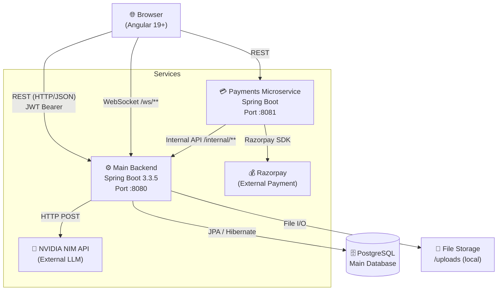
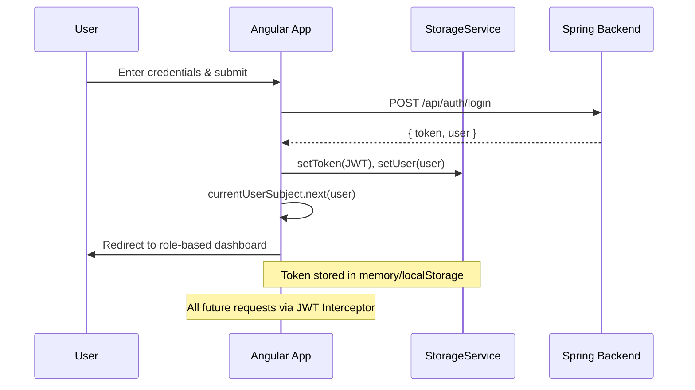
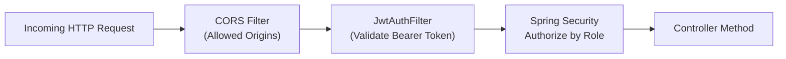
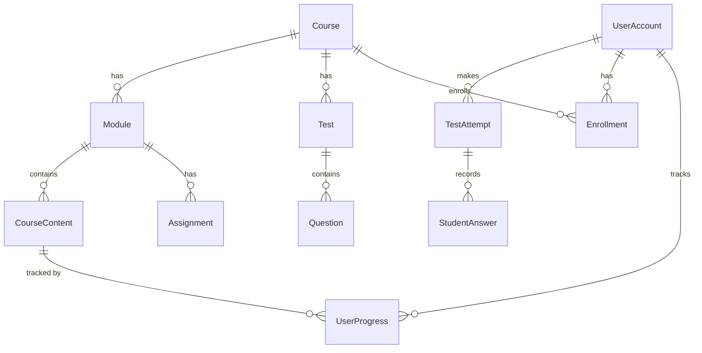
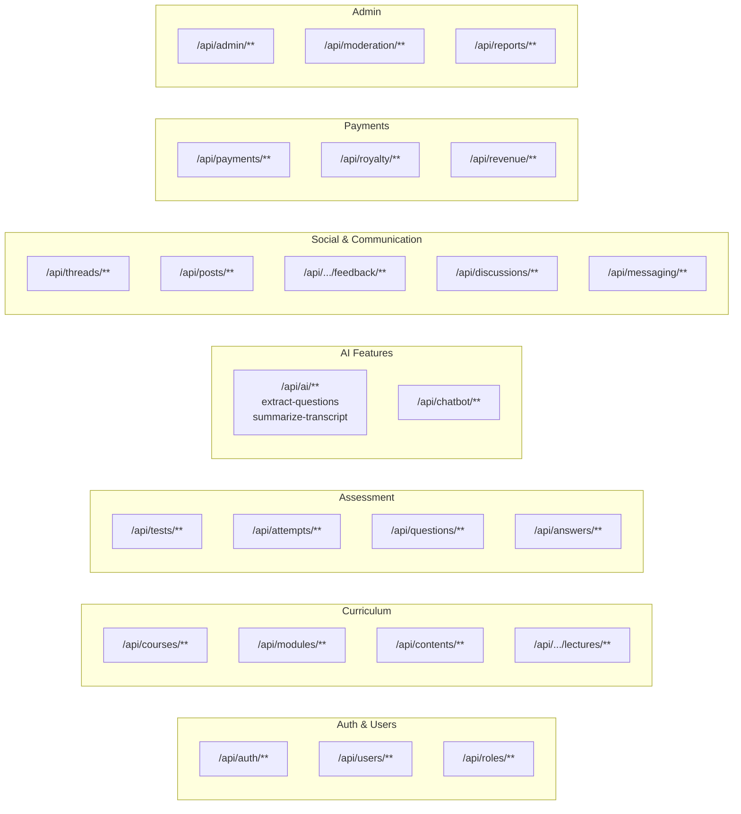
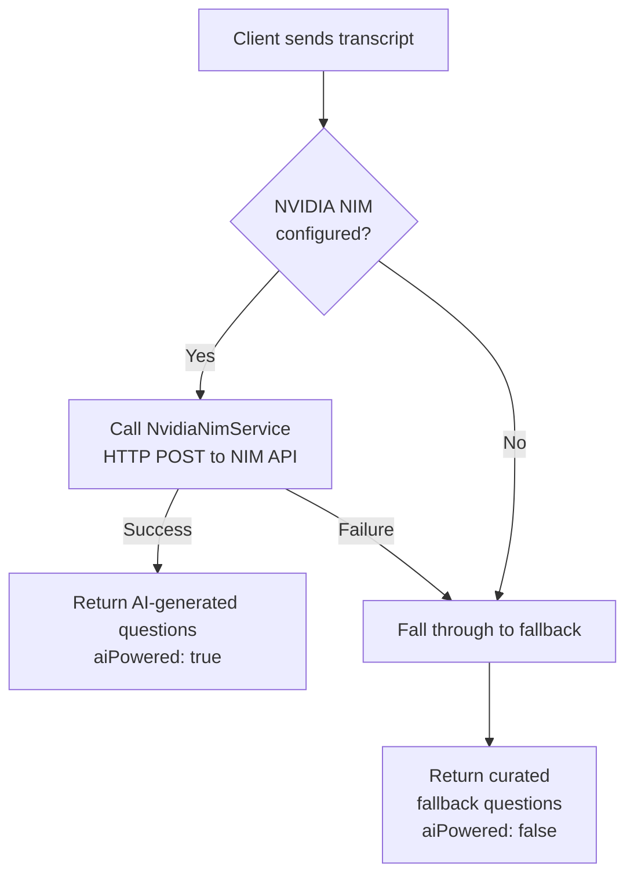
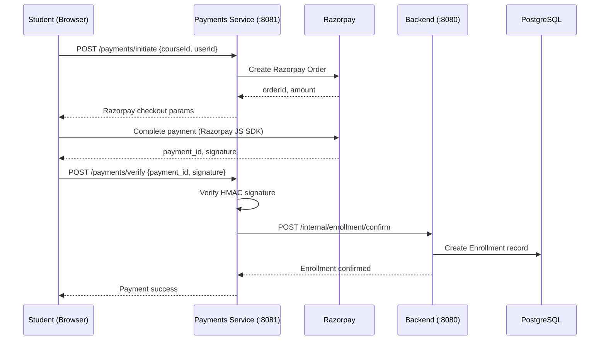
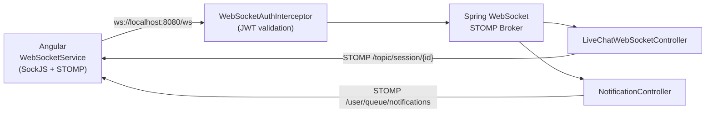
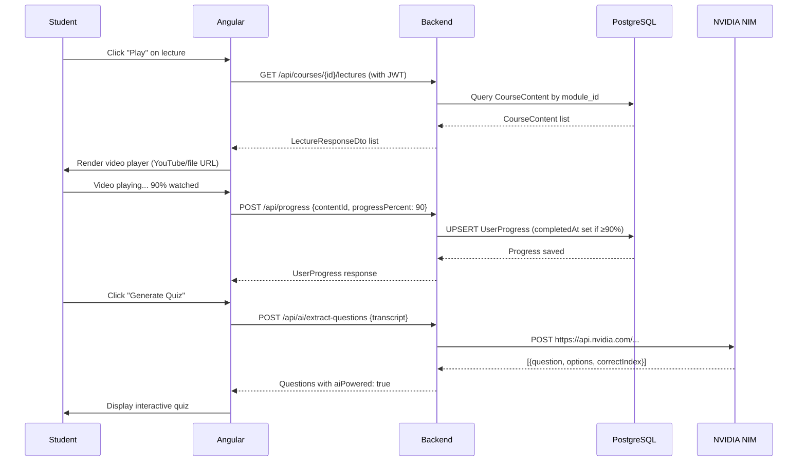

# LearnSphere AI — System Design Document

> A deep-dive into the architecture, data flow, design decisions, and trade-offs of the LearnSphere AI Online Learning Platform.

---

## 1. High-Level Architecture Overview

LearnSphere is a **distributed, 3-tier web application** composed of three independently deployable services communicating over HTTP/REST and WebSockets.



---

## 2. Frontend Architecture (Angular 19)

### 2.1 Feature-Based Module Structure

The frontend follows a **clean 3-layer architecture**:

```
src/app/
├── core/               ← Singleton services, guards, interceptors, models
│   ├── auth/           ← AuthService, auth.models, auth.guards
│   ├── guards/         ← AuthGuard, RoleGuard
│   ├── interceptors/   ← JWT Interceptor (attaches Bearer token)
│   ├── models/         ← Shared TypeScript interfaces
│   └── services/       ← ApiService, StorageService, WebSocketService, etc.
│
├── features/           ← Role-based feature modules (lazy loaded)
│   ├── auth/           ← Login, Register, Forgot Password pages
│   ├── student/        ← Dashboard, Course Player, Progress, Profile
│   ├── teacher/        ← Course Builder, Lectures, Assessments, Students
│   ├── admin/          ← User Management, Reports, Moderation
│   ├── public/         ← Course Catalog, Landing Page
│   └── payment/        ← Checkout, Order History
│
├── shared/             ← Reusable UI components (buttons, modals, cards)
└── store/              ← State management (signals/BehaviorSubjects)
```

### 2.2 Authentication Flow (Frontend)



### 2.3 Role-Based Routing

Three distinct portal views are guarded by `RoleGuard`:

| Role | Dashboard Route | Capabilities |
|------|----------------|--------------|
| `STUDENT` | `/student/dashboard` | Browse, enroll, watch, take tests |
| `TEACHER` | `/teacher/dashboard` | Create courses, manage content, grade |
| `ADMIN` | `/admin/dashboard` | User management, reports, moderation |

---

## 3. Backend Architecture (Spring Boot 3.3.5)

### 3.1 Layered Package Structure

```
com.MOOC.OnlineLearningPlatfrom/
├── Config/         ← SecurityConfig, WebSocketConfig, WebConfig, DataSeeder
├── Controller/     ← 45 REST Controllers (API surface layer)
├── Service/        ← Business logic (interfaces + impl)
├── Repository/     ← Spring Data JPA repositories
├── Entity/         ← 36 JPA entities
├── Dto/            ← Request/Response DTOs (decoupled from entities)
├── Security/       ← JwtService, JwtAuthFilter, CustomUserDetails
└── Exception/      ← Global exception handlers
```

### 3.2 Security Architecture



**Key security decisions:**
- **Stateless sessions**: `SessionCreationPolicy.STATELESS` — no server-side session storage
- **BCrypt passwords**: All passwords hashed with BCrypt encoder
- **JWT claims**: `userId`, `roles`, `dept_id` embedded in token
- **Role-based URL guards**: `/api/admin/**` → `ROLE_ADMIN`, `/api/teacher/**` → `ROLE_TEACHER`
- **Public endpoints**: Auth, course browsing, certificates verify, file uploads, AI endpoints

### 3.3 WebSocket Support

Real-time communication powered by Spring WebSocket:
- **Endpoint**: `/ws/**` (STOMP over SockJS)
- **Auth**: `WebSocketAuthInterceptor` validates JWT before handshake
- **Use cases**: Live chat in sessions, real-time notifications

---

## 4. Domain Model (Entity Relationship)

### 4.1 Core Curriculum Decomposition



### 4.2 All 36 Entities at a Glance

| Domain | Entities |
|--------|----------|
| **Auth & Identity** | `UserAccount`, `UserRole`, `Role`, `Department`, `College`, `AffiliationRequest` |
| **Curriculum** | `Course`, `Module`, `CourseContent`, `Lecture` |
| **Assessment** | `Test`, `TestAttempt`, `Question`, `StudentAnswer` |
| **Assignments** | `Assignment`, `AssignmentSubmission` |
| **Progress & Certs** | `UserProgress`, `Certificate`, `Leaderboard` |
| **Social** | `DiscussionThread`, `DiscussionPost`, `Post`, `Feedback`, `Announcement` |
| **Communication** | `Conversation`, `Message`, `Notification` |
| **Payments** | `Payment`, `Payout`, `Royalty` |
| **Utility** | `Bookmark`, `Note`, `FlaggedContent`, `LiveSession`, `PasswordResetToken` |

---

## 5. API Design

### 5.1 REST Endpoint Surface (45 Controllers)



### 5.2 HTTP Communication Pattern

```
Angular Service → ApiService.get/post/put/delete()
                → Attaches Authorization: Bearer <token> via Interceptor
                → Calls Spring Backend REST endpoint
                → Spring returns DTO (never raw Entity)
                → Angular maps to TypeScript interface
```

---

## 6. AI Integration (NVIDIA NIM)

### 6.1 Design Pattern — Graceful Degradation



**Key AI Endpoints:**
| Endpoint | Purpose |
|----------|---------|
| `POST /api/ai/extract-questions` | Generate MCQ quiz from video transcript |
| `POST /api/ai/summarize-transcript` | Summarize lecture content in any language |
| `GET /api/ai/status` | Check if NVIDIA NIM is live |
| `POST /api/chatbot/**` | Conversational AI tutoring |

---

## 7. Payments Architecture

### 7.1 Two-Service Payment Flow



### 7.2 Royalty System
- After payment, instructor royalties tracked in `Royalty` entity
- Admin manages payouts via `PayoutAdminController`
- Revenue analytics via `RevenueController`

---

## 8. Real-Time Features

### 8.1 WebSocket Architecture



**Real-time use cases:**
- 💬 Live session chat between instructor and students
- 🔔 Instant notifications (enrollment confirmed, grade posted, etc.)

---

## 9. Data Flow: Student Watches a Video

This end-to-end flow illustrates how all layers connect:



---

## 10. Key Design Decisions & Trade-offs

| Decision | Choice Made | Trade-off |
|----------|-------------|-----------|
| **Monolith vs Microservices** | Hybrid — main monolith + payments microservice | Simplicity for core + isolation for payment sensitivity |
| **Session Management** | Stateless JWT (no server sessions) | Scalable horizontally, but token revocation is harder |
| **ORM Strategy** | Spring Data JPA + Hibernate | Rapid development, but N+1 queries risk on deep associations |
| **File Storage** | Local `/uploads` directory | Simple to start, not horizontally scalable (should move to S3) |
| **AI Reliability** | Graceful fallback from NVIDIA NIM to curated Q&A | Always works even if AI API is down |
| **WebSocket Auth** | Custom interceptor (not HTTP session) | Stateless consistency, slightly more complex setup |
| **Frontend State** | BehaviorSubjects (RxJS) | Reactive, simpler than NgRx but less powerful for complex state |
| **Database** | PostgreSQL (single DB) | ACID compliance, relational integrity for all 36 entities |

---

## 11. Scalability Bottlenecks & Future Improvements

### Current Limitations
| Area | Issue | Solution |
|------|-------|----------|
| **File Storage** | Local disk `/uploads` — not shareable across instances | Migrate to AWS S3 / GCS |
| **Leaderboard** | Computed synchronously after test submit | Move to async event-driven (Kafka/RabbitMQ) |
| **Session state** | Single backend instance for WS connections | Add Redis pub/sub for multi-instance WS |
| **AI Calls** | Synchronous HTTP call to NVIDIA NIM blocks thread | Use async `@Async` or reactive WebClient |
| **DB connections** | Default HikariCP pool | Tune pool size for production load |

### Recommended Next Steps
1. 🗃️ Add **Redis** for caching hot data (course lists, leaderboards)
2. 📨 Add **async messaging** (Kafka) for leaderboard recalculation
3. ☁️ Migrate file uploads to **AWS S3**
4. 🔄 Add **token refresh** endpoint and silent rotation in Angular
5. 📊 Add **Prometheus + Grafana** for observability

---

## 12. Tech Stack Summary

| Layer | Technology | Version |
|-------|-----------|---------|
| Frontend Framework | Angular (Standalone Components) | 19+ |
| Frontend Language | TypeScript | Latest |
| Frontend Styling | SCSS (Glassmorphic UI) | - |
| Backend Framework | Spring Boot | 3.3.5 |
| Backend Language | Java | 17/21 |
| ORM | Spring Data JPA + Hibernate | - |
| Database | PostgreSQL | - |
| Auth | JWT (jjwt library) | - |
| Password Hashing | BCrypt | - |
| Real-time | WebSocket (STOMP over SockJS) | - |
| AI | NVIDIA NIM LLM API | External |
| Payments | Razorpay SDK | External |
| Video Import | YouTube Data API | External |
| Build Tool (BE) | Maven | - |
| Build Tool (FE) | Angular CLI / npm | - |
